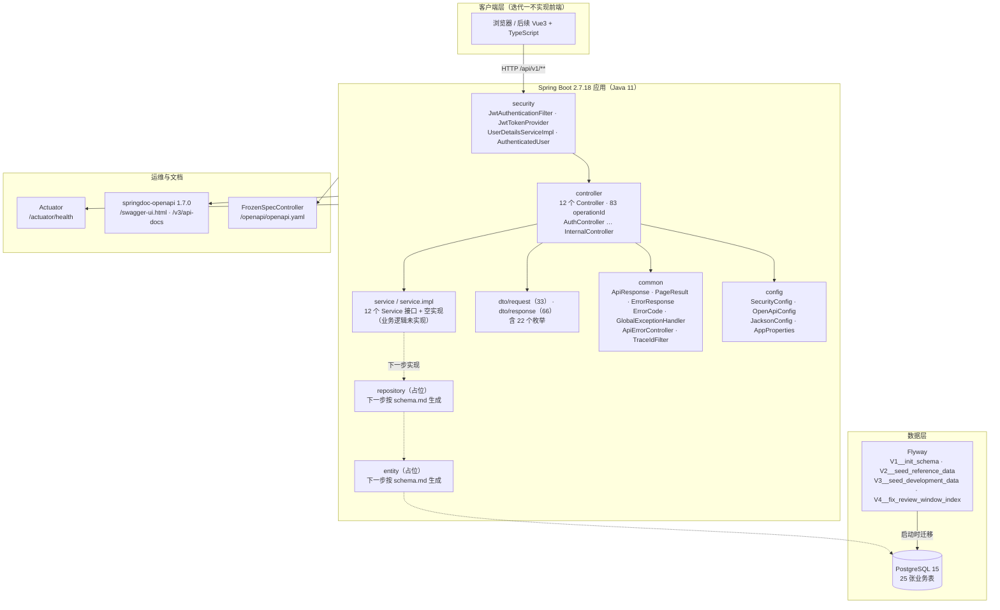
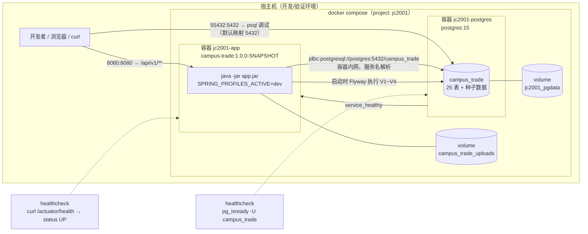
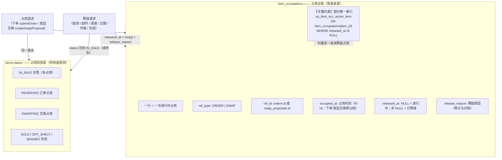
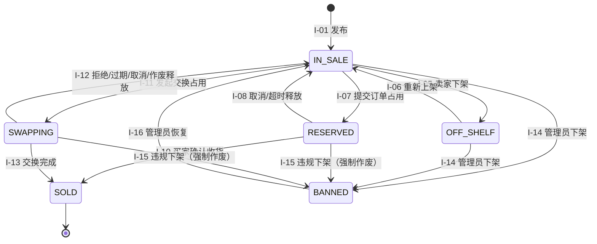
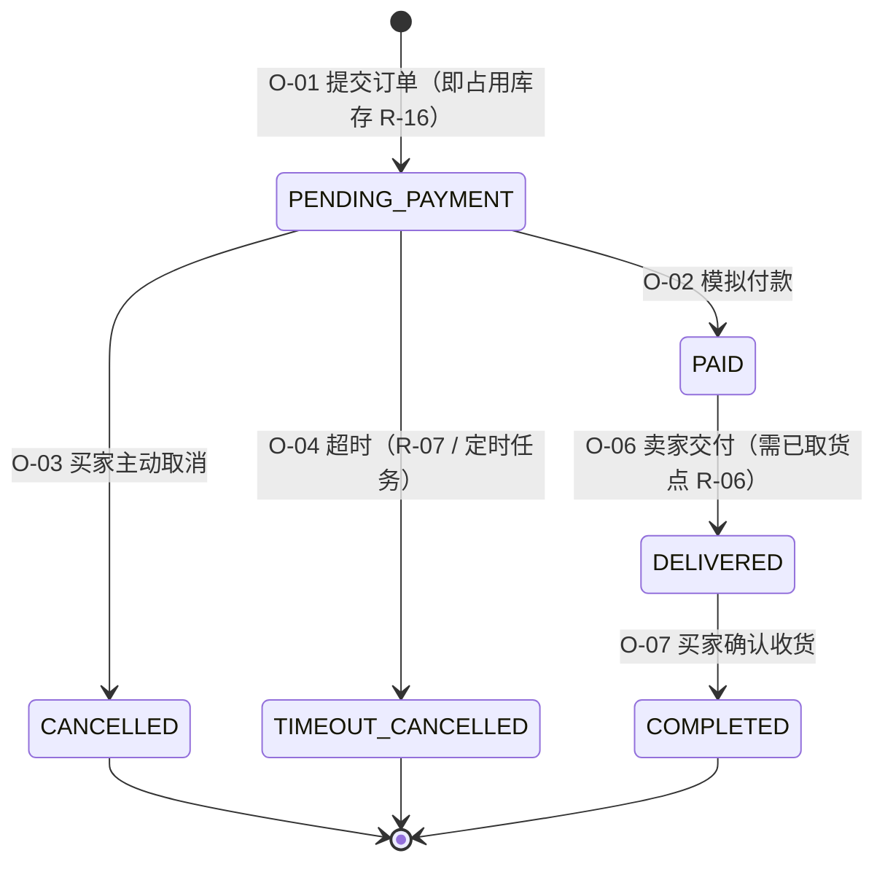
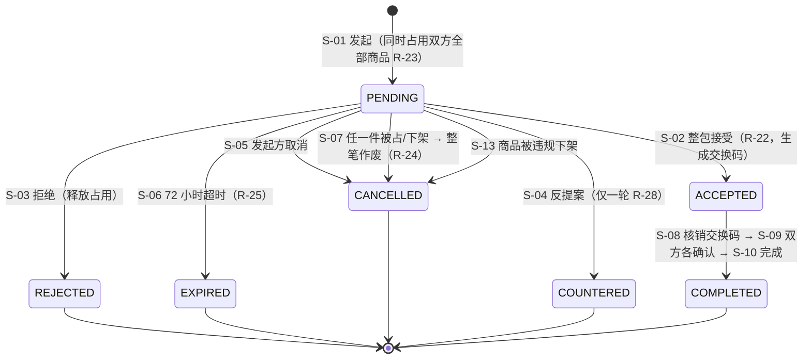
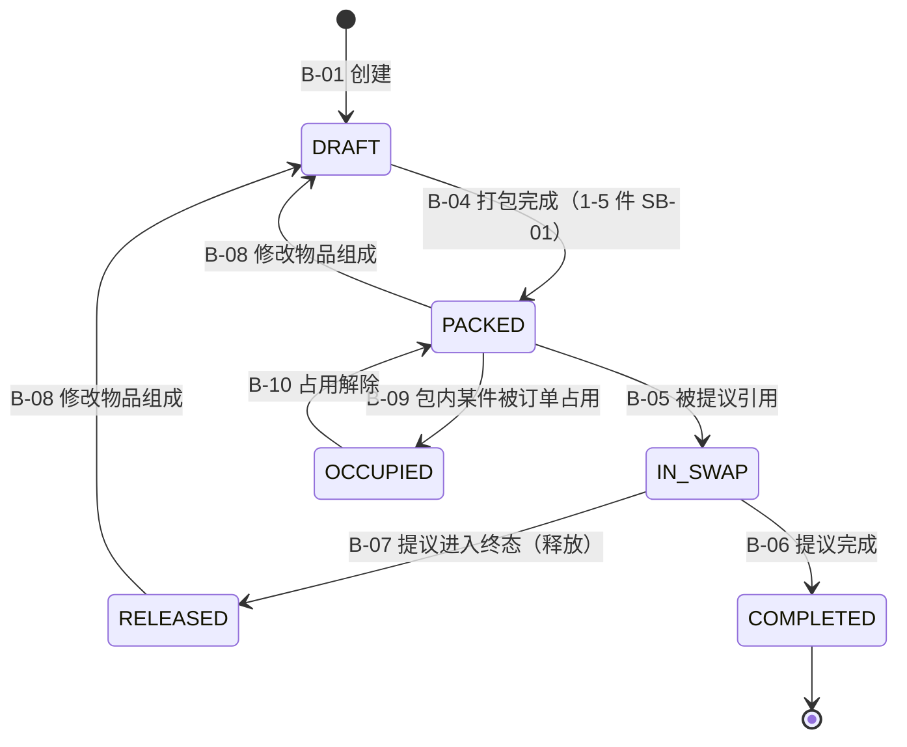
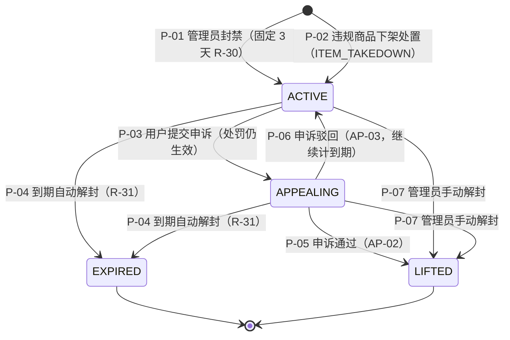
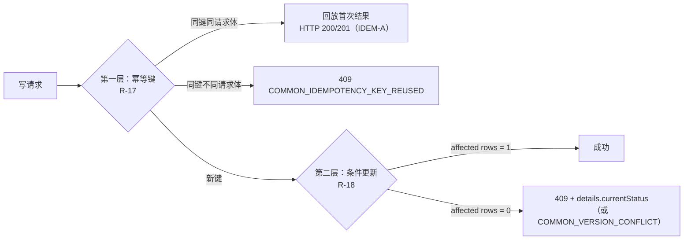

# 迭代一 系统设计文档（System Design）

| 项目 | 内容 |
| --- | --- |
| 文档名称 | 迭代一 系统设计文档 |
| 版本 | v1.0 |
| 日期 | 2026-10-12 |
| 作者 | 系统设计文档负责人（待填写姓名） |
| 状态 | 草稿（待确认） |
| 技术栈 | Java 11 + Spring Boot 2.7.18 + PostgreSQL 15（固定） |
| 契约版本 | `1.0.0-frozen-candidate`（冻结候选，73 paths / 83 operations / 99 schemas） |
| 文档定位 | **迭代一设计内容的统一入口**：整合架构、领域模型、状态机与规则、权限、接口清单、不做清单与假设 |
| 上游依据 | 需求基线（8 份）、数据库设计（4 份 + 迁移 V1~V4）、接口契约（7 份）、工程骨架、接口骨架 |

---

## 0. 文档定位与阅读指引

本文件是迭代一**设计内容的统一收口**。此前各步产出分散在多个文件中，本文件做的是
**整合与交叉引用**，不复制全部细节，也**不修改**任何上游文档。

### 0.1 阅读顺序（推荐）

```text
① 需求基线        docs/iteration1/requirements.md 等 8 份
② 数据库设计      docs/iteration1/design/schema.md、er-diagram.md
③ 接口契约        docs/iteration1/design/openapi.yaml、api-contract.md
④ 设计文档        本文件（SystemDesign.md）          ← 你在这里
⑤ 时序图          docs/iteration1/design/sequence-diagrams.md
```

### 0.2 本文件与上游文档的关系（权威顺序）

| 内容 | 权威来源 | 本文件的作用 |
| --- | --- | --- |
| 需求与范围 | `requirements.md` / `out-of-scope.md` | 摘要 + 引用 |
| 表结构与字段 | `V1__init_schema.sql` / `schema.md` | 摘要 + 引用 |
| 状态与转换 | `state-machines.md` | 摘要 + 引用（转换编号一致） |
| 业务规则 | `rules.md`（R-01~R-35） | 摘要 + 引用 |
| 接口定义 | `openapi.yaml` | 摘要 + 引用（operationId 一致） |
| 权限 | `permission-matrix.md` / `api-permission-mapping.md` | 摘要 + 引用 |
| 错误码 | `error-codes.md` | 摘要 + 引用 |
| 幂等与并发 | `idempotency-and-concurrency.md` | 摘要 + 引用 |

> **冲突处理**：若本文件与上述权威来源不一致，**以权威来源为准**，并在
> `design-doc-verification.md` 中登记为待确认问题。

---

## 1. 项目概述与迭代一范围

### 1.1 一段话定位

本平台面向**高校校区及周边社区**内的师生与居民，解决「闲置物品在熟人半径内难以低成本、
低信任门槛地流转」的问题：卖家把闲置挂出，按**预设交易区域 + 公共取货点**完成线下当面交付；
买家可**直接购买**，也可用自己的闲置**以物换物**。
平台**不读定位、不填住址、不做地图、不做物流**，用「固定取货点 + 交换码 / 交付确认」
替代复杂的地理与信任基础设施。

### 1.2 服务范围

| 项 | 内容 | 状态 |
| --- | --- | --- |
| 服务对象 | **2–3 个校区**及周边社区的师生与居民 | 【待确认 Q-01】 |
| 交易区域 | 后台**预设字典**，用户仅可勾选 1–5 个，不可自由输入 | 占位数据 `CAMPUS_A`/`COMMUNITY_A1` 等 |
| 公共取货点 | 归属交易区域，6 种类型（图书馆门口/食堂门口/教学楼大厅/宿舍区门口/校门口/社区广场） | 【待确认 Q-03】 |
| 地理红线 | **不读定位、不填住址、不做地图导航、不做距离排序** | 已冻结（GEO-01~GEO-04 / OOS-05~OOS-07） |

### 1.3 迭代一交付边界

| 类别 | 交付 | 不交付 |
| --- | --- | --- |
| 需求 | 需求说明书、不做清单、权限矩阵、状态机、规则、页面流程、术语与假设 | 用户调研、竞品分析 |
| 设计 | **本文件**、ER 图、字段字典、**时序图** | 生产级部署方案、容量规划 |
| 接口 | OpenAPI 契约（83 操作）+ 接口清单 + 错误码 + 幂等并发说明（**10/9 后不许新增**） | 接口业务实现 |
| 工程 | 可编译/可启动的 Spring Boot 骨架、Docker Compose、Flyway 迁移 V1~V4 | 业务逻辑实现 |
| 接口骨架 | 12 个 Controller 覆盖 83 个 operationId（方法体抛 `UnsupportedOperationException`） | 前端可点击原型、使用说明书 |

**一句话**：迭代一结束时团队应能**凭契约直接开始编码**，但系统**尚不能完成一笔真实交易**。

---

## 2. 系统架构

### 2.1 分层架构



| 层 | 包 | 职责 | 迭代一状态 |
| --- | --- | --- | --- |
| 安全层 | `security` | JWT 解析、认证上下文 | 骨架（过滤器不强制认证） |
| 接口层 | `controller` | 路径映射、参数绑定、权限注解、响应包络 | ✅ 83 个 operationId 全部就位 |
| 传输对象 | `dto/request`、`dto/response` | 请求/响应 DTO，与契约 Schema 1:1 | ✅ 99 个 Schema 全覆盖 |
| 业务层 | `service`、`service/impl` | 业务逻辑（状态转换、占用、幂等） | ⚠️ **仅接口 + 空实现**（抛 `UnsupportedOperationException`） |
| 数据访问 | `repository` | JPA 仓储 | 占位包 |
| 实体层 | `entity` | JPA 实体映射 25 张表 | 占位包 |
| 公共层 | `common` | 统一响应、异常、错误码、traceId | ✅ 已就绪 |
| 配置层 | `config` | Security / OpenAPI / Jackson / 自定义配置 | ✅ 已就绪 |

> **分层依赖方向**：`controller → service → repository → entity`，`common`/`config` 被各层共用。
> **响应包络属接口层职责**：`ApiResponse` 由 Controller 组装，**不下沉到 Service**
> （Service 返回原始领域类型，见 `controller-skeleton-verification.md` §10.1）。

### 2.2 部署拓扑（Docker Compose）



| 组件 | 镜像 / 构建 | 端口（默认 → 容器） | 健康检查 |
| --- | --- | --- | --- |
| `postgres` | `postgres:15` | `5432 → 5432`（可覆盖 `POSTGRES_HOST_PORT`） | `pg_isready -U campus_trade -d campus_trade` |
| `app` | 本目录 `Dockerfile`（复制 jar，不做 Maven 构建） | `8080 → 8080`（可覆盖 `APP_HOST_PORT`） | `curl /actuator/health` 断言 `"status":"UP"` |

**启动依赖**：`app` 通过 `depends_on: postgres: condition: service_healthy` 等待数据库就绪，
避免 Flyway 连接失败导致启动中断。

**构建策略**（重要）：默认 `Dockerfile` 是**运行镜像**，只 `COPY target/campus-trade.jar`，
不在容器内执行 Maven；`Dockerfile.build` 保留容器内完整构建（含依赖层缓存）供 CI 使用。
原因：容器内全新构建需重新下载全部依赖，实测约 38 分钟；复制产物后镜像构建约 **9~10 秒**。

> **环境说明**：本次搭建环境宿主机 `5432` 被**无关容器**占用，验证时用
> `POSTGRES_HOST_PORT=55432` 覆盖；**交付文件默认映射仍为 5432**，
> 且 `app` 容器内部始终用服务名 `postgres:5432`，不受该覆盖影响。

### 2.3 关键技术选型与理由

| 技术 | 版本 | 选型理由 |
| --- | --- | --- |
| **Java** | 11 | 迭代一固定要求；具备 `var`、`HttpClient` 等特性，且为当时 LTS |
| **Spring Boot** | 2.7.18 | 迭代一固定要求；2.7.x 是支持 Java 11 的最后一个 2.x 分支，生态成熟 |
| **Spring Security** | 随 Boot 2.7 | Bearer JWT 无状态认证；`@PreAuthorize` 方法级权限（已按契约生成 83 处注解） |
| **Spring Data JPA** | 随 Boot 2.7 | 实体映射与仓储；`ddl-auto=validate` 保证**表结构只由 Flyway 管理** |
| **PostgreSQL** | 15 | 迭代一固定要求；关键收益是**部分唯一索引**（`WHERE` 子句索引），
用于表达「一个商品同时最多一个进行中占用」这类排他约束（C-01/R-23）——数据库级保证而非应用层约定 |
| **Flyway** | 8.5.13（Boot 托管） | 版本化迁移、checksum 校验；启动时自动执行 V1~V4。
**不升级到 9/10**：Boot 2.7 的 `FlywayAutoConfiguration` 绑定 Flyway 8 的 `Configuration` API（9.x 已移除），
Flyway 10 要求 Java 17（与固定 Java 11 冲突）。详见 `backend-skeleton-verification.md` §10 |
| **springdoc-openapi** | 1.7.0 | 兼容 Spring Boot 2.7；`springdoc-openapi-ui` 提供 Swagger UI；
同时暴露**已冻结契约**（`/openapi/openapi.yaml`）与**运行时文档**（`/v3/api-docs`）供对照 |
| **Jackson** | 随 Boot 2.7 | 统一 ISO 8601 UTC 时间格式（AD-05）；`non_null` 输出以对齐契约「无数据时不出现 data」 |
| **Bean Validation** | 随 Boot 2.7 | 契约约束（required / maxLength / minimum）已生成为 `@NotNull`/`@Size`/`@Min`/`@Max` |
| **Micrometer Actuator** | 随 Boot 2.7 | `/actuator/health` 供 Docker HEALTHCHECK 与编排层使用（含 `db` 组件） |
| **JWT (jjwt)** | 0.11.5 | 令牌签发与解析骨架；HS256（密钥 ≥32 字节，启动时快速失败） |
| **juint / spring-boot-starter-test** | 随 Boot 2.7 | 测试基础设施（骨架阶段未编写业务测试） |

**未采用的技术及原因**

| 技术 | 未采用原因 |
| --- | --- |
| Lombok | 需联网拉取且引入注解处理；改为生成显式访问器，零新增依赖（见 `controller-skeleton-verification.md` §5.5） |
| 对象存储 / CDN | OOS-18：迭代一用服务端本地目录 |
| Redis / 缓存 | 迭代一无性能压力；且部分唯一索引已能表达排他语义 |
| 消息队列 | 迭代一无异步投递需求；通知为站内同步写入 `notifications` |
| MapStruct 等映射框架 | DTO 与实体分离但骨架阶段无映射逻辑 |

---

## 3. 领域模型

### 3.1 核心实体关系图

完整 ER 图（4 张，含总览、占用、交换、治理详图）见
[`er-diagram.md`](./er-diagram.md)。以下为**核心交易链路总览**（内嵌便于评审阅读）：

```mermaid
erDiagram
    users ||--o{ user_trade_zones : "勾选 1-5 个常用区域 (FR-107)"
    trade_zones ||--o{ user_trade_zones : "被勾选"
    trade_zones ||--o{ pickup_points : "包含公共取货点 (R-06)"
    trade_zones ||--o{ items : "商品所属区域 (R-15)"
    trade_zones ||--o{ orders : "订单区域 (R-15)"

    categories ||--o{ items : "分类 (FR-206)"
    item_conditions ||--o{ items : "成色 (FR-207)"
    users ||--o{ items : "作为卖家发布"
    items ||--o{ item_images : "1-9 张图片 (FR-205)"

    users ||--o{ cart_items : "购物车 (FR-301)"
    items ||--o{ cart_items : "被加入"

    users ||--o{ orders : "作为买家 buyer_id"
    users ||--o{ orders : "作为卖家 seller_id（一单一卖家 C-02）"
    pickup_points ||--o{ orders : "选定取货点 (R-06)"
    orders ||--|{ order_items : "订单明细 ≥1"
    items ||--o{ order_items : "被下单（含快照 R-13）"
    orders ||--o| payments : "模拟付款记录 (R-08)"

    items ||--o{ item_occupations : "占用台账 (C-01/R-16/R-23 核心)"

    users ||--o{ swap_bundles : "作为包主 (SB-02)"
    swap_bundles ||--|{ swap_bundle_items : "包含 1-5 件 (SB-01)"
    items ||--o{ swap_bundle_items : "被放入交换包"

    users ||--o{ swap_proposals : "作为发起方 proposer"
    users ||--o{ swap_proposals : "作为目标方 target"
    swap_bundles ||--o{ swap_proposals : "作为发起方交换包"
    swap_proposals ||--|{ swap_proposal_items : "目标商品 ≥1 (C-04)"
    items ||--o{ swap_proposal_items : "被请求"
    swap_proposals ||--o| swap_codes : "一次性交换码 (C-05/R-26)"
    swap_proposals ||--o{ swap_proposals : "反提案父子 (R-28 仅一轮)"

    users ||--o{ reviews : "评价人 / 被评价人"
    orders ||--o{ reviews : "订单评价 (R-14)"
    swap_proposals ||--o{ reviews : "交换评价"

    users ||--o{ reports : "举报人 (FR-211)"
    items ||--o{ reports : "被举报商品"

    users ||--o{ penalties : "被处罚用户 / 操作管理员"
    items ||--o{ penalties : "违规下架处置 (P-02)"
    penalties ||--o| appeals : "申诉 (AP-01 一罚一诉)"

    users ||--o{ notifications : "接收通知 (FR-507)"
    users ||--o{ idempotency_records : "幂等键归属 (R-17)"
    users ||--o{ audit_logs : "操作者 (R-34)"
```



### 3.2 实体说明

数据库共 **25 张业务表 / 324 列**，字段字典见 [`schema.md`](./schema.md)。按域分组：

| 域 | 表 | 说明 |
| --- | --- | --- |
| **参照字典** | `trade_zones`、`pickup_points`、`categories`、`item_conditions` | 预设数据，用户只能选择不可新增（R-15 / FR-206 / FR-207） |
| **用户与账户** | `users`、`user_trade_zones` | `users` 合并「用户 + 个人资料」（严格 1:1，决策 D-02）；`role` 仅 `USER`/`ADMIN`，卖家/买家是**关系角色**不落库 |
| **商品** | `items`、`item_images` | `items.status` 是**占用的投影**；`estimated_price` 为卖家自填估价（R-13 平台不定价） |
| **占用台账** | `item_occupations` | **全库唯一表达「商品被谁占用」的台账**；`released_at IS NULL` 表示进行中 |
| **购物车与订单** | `cart_items`、`orders`、`order_items`、`payments` | `orders.seller_id` 落实**一单一卖家**（C-02）；`payments` 仅 `MOCK` 渠道（OOS-01） |
| **交换** | `swap_bundles`、`swap_bundle_items`、`swap_proposals`、`swap_proposal_items`、`swap_codes` | 交换包 1–5 件；提议参与方恰好两个；`counter_depth ≤ 1` 落实反提案仅一轮（R-28） |
| **评价与举报** | `reviews`、`reports` | 评价同时支持订单与交换（二选一 CHECK）；举报未处理唯一（C-06） |
| **治理** | `penalties`、`appeals` | **永不物理删除**（R-32）；无 `deleted_at`，外键一律 `ON DELETE RESTRICT` |
| **通知** | `notifications` | 站内通知；`ref_type`/`ref_id` 多态引用供前端跳转 |
| **幂等与审计** | `idempotency_records`、`audit_logs` | R-17 幂等键层；R-34 治理动作留痕 |

**关键设计决策**（详见 `open-questions.md` §4 的 DD-01~DD-19）：

| 编号 | 决策 | 理由 |
| --- | --- | --- |
| DD-01 | 引入 `item_occupations` 台账，`items.status` 仅为投影 | C-01/R-23 需要数据库级排他保证；单靠 `items.status` 无法表达「被谁占用」 |
| DD-02 | 「用户」与「个人资料」合并为 `users` | 严格 1:1、无独立生命周期，拆表只增加 JOIN |
| AD-09 | 枚举取值与 `V1__init_schema.sql` **逐字一致** | 避免 API 与数据库枚举漂移（已核验 21/21 一致） |

### 3.3 占用与释放模型

**这是本设计最核心的机制**，同时承载 C-01（一物一占用）与 R-23（订单占用与交换占用互斥）。



**占用生命周期（文本化）**

```text
【占用】下单 / 发起交换
   ├─ 写 item_occupations(item_id, ref_type, ref_id, occupied_at=now(), released_at=NULL)
   ├─ 更新 items.status → RESERVED（ref_type=ORDER）或 SWAPPING（ref_type=SWAP）
   └─ 同一事务提交；若唯一索引冲突（23505）→ 409 域错误码

【释放】取消 / 超时 / 拒绝 / 过期 / 作废 / 完成
   ├─ UPDATE item_occupations SET released_at=now(), release_reason=? WHERE ... AND released_at IS NULL
   ├─ 更新 items.status → IN_SALE（被下架的除外，保持 OFF_SHELF/BANNED）
   └─ 幂等：重复释放不产生副作用（IDEM-B）
```

| 不变量 | 承载约束 | 对应需求 | 数据库级强制 |
| --- | --- | --- | --- |
| 一物一占用 | `uq_item_occ_active_item` | C-01 / R-16 | ✅ **是** |
| 订单占用与交换占用互斥 | 同上（同一索引统一保证） | R-23 | ✅ **是** |
| 同一商品不能同时进入两个进行中交换包 | `uq_swap_bundle_items_active`（`WHERE item_status='ACTIVE'`） | SB-03 / R-21 | ✅ **是** |
| `items.status` 与台账一致 | 应用层同事务维护 + 对账查询 | R-16 | ⚠️ 跨表，靠事务 + `db/verify_schema.sql` §11 校验 |

> **为什么必须在同一事务**：数据库无法用约束表达「台账与投影一致」这一跨表不变量（DD-01 / DQ-07）。
> 因此落地要求是：**写台账与写投影必须在同一事务内完成**，并提供对账查询作为兜底检测。

---

## 4. 状态机与交易规则

状态枚举与转换编号**严格对齐** [`state-machines.md`](../state-machines.md)；
数据库中以 PostgreSQL ENUM 落地（21 个业务枚举，与 `V1__init_schema.sql` 逐字一致）。

### 4.1 商品状态机（`item_status`）

| 状态 | 含义 | 对访客可见 |
| --- | --- | --- |
| `DRAFT` | 草稿（**本迭代不使用**，见 DQ-01：发布即上架） | 否 |
| `IN_SALE` | 在售，可被浏览/加购/发起交换 | 是 |
| `RESERVED` | **订单占用** | 部分（详情可见但不可下单） |
| `SWAPPING` | **交换占用** | 部分（详情展示交换中） |
| `SOLD` | 已售出（业务终态） | 否 |
| `OFF_SHELF` | 卖家主动下架 | 否 |
| `BANNED` | 违规下架（管理员处置） | 否 |



**关键约束**：`RESERVED` 与 `SWAPPING` **互斥**（同一商品不可能同时处于两者，R-23）；
`SOLD` 为终态，任何转换拒绝（I-17 / IDEM-C）。

### 4.2 订单状态机（`order_status`）

| 状态 | 含义 | 商品占用 | 倒计时 |
| --- | --- | --- | --- |
| `PENDING_PAYMENT` | 待付款 | 是（`RESERVED`） | **30:00 倒计时**（A-01） |
| `PAID` | 已付款 / 待取货 | 是 | 无 |
| `DELIVERED` | 已交付待确认 | 是 | 无 |
| `COMPLETED` | 已完成（终态） | 否（商品→`SOLD`） | 无 |
| `CANCELLED` | 买家主动取消（终态） | 否（已释放） | 无 |
| `TIMEOUT_CANCELLED` | 超时取消（终态） | 否（已释放） | 无 |



> **不做的转换**：已付款**不可**自助取消（O-08 / Q-08），无退款状态（OOS-14）。
> 商品被管理员违规下架时，`PENDING_PAYMENT` 订单由系统联动取消（O-11，`cancel_reason=ADMIN_TAKEDOWN`）。

### 4.3 交换提议状态机（`swap_proposal_status`）

| 状态 | 含义 | 是否占用商品 |
| --- | --- | --- |
| `PENDING` | 待处理（72 小时有效期 A-02） | 是（**双方商品**） |
| `ACCEPTED` | 已接受（生成一次性交换码 C-05） | 是 |
| `REJECTED` | 已拒绝 | 否（已释放） |
| `COUNTERED` | 已反提案（原提议终结，占用转移给新提议） | 否 |
| `EXPIRED` | 已过期（72 小时，R-25） | 否（已释放） |
| `CANCELLED` | 已取消（含**整笔作废** R-24） | 否（已释放） |
| `COMPLETED` | 已完成（双方确认 R-27） | 否（商品→`SOLD`） |



**`swap_termination_reason`**（终结原因，`CANCELLED` 时必填）：
`TARGET_REJECTED`、`PROPOSER_CANCELLED`、`EXPIRED_72H`、
**`VOID_ITEM_OCCUPIED`**、**`VOID_ITEM_OFF_SHELF`**、**`VOID_ITEM_BANNED`**（后三者即整笔作废）、`COUNTERED`。

> **`COUNTERED` 是中间态**：反提案会**新建一条** `PENDING` 提议（`counter_depth=1`）。
> `ck_swap_proposals_counter_depth CHECK (counter_depth BETWEEN 0 AND 1)` 在数据库级禁止
> 「反提案的反提案」（R-28 / A-10）。

### 4.4 交换包状态机（`swap_bundle_status`）

| 状态 | 含义 |
| --- | --- |
| `DRAFT` | 草稿（可自由增删物品） |
| `PACKED` | 已打包（1–5 件，可用于发起提议） |
| `IN_SWAP` | 已被进行中提议引用 |
| `OCCUPIED` | 包内存在被占用物品，导致本包不可用 |
| `RELEASED` | 关联提议终结后释放，包可再用或修改 |
| `COMPLETED` | 关联提议已完成交换（终态） |



**约束**：包内 1–5 件（SB-01）；所有物品必须同属包主（SB-02）；
同一物品同一时间只能在一个**进行中**包内（SB-03）；
包被进行中提议引用期间不可修改（SB-04）。

### 4.5 处罚与申诉状态机

**处罚（`penalty_status`）**

| 状态 | 含义 | 用户能否交易 |
| --- | --- | --- |
| `ACTIVE` | 生效中（封禁进行中） | 否 |
| `APPEALING` | 申诉中（**处罚仍然生效，不停表**） | 否 |
| `LIFTED` | 已解封（申诉通过或管理员手动） | 是 |
| `EXPIRED` | 已过期（到期自动解封） | 是 |

**申诉（`appeal_status`）**：`SUBMITTED` → `APPROVED` / `REJECTED`



**`penalty_type`**：`BAN_3D`（封禁三天，影响交易能力）、`ITEM_TAKEDOWN`（违规下架处置，**仅举证**）。
**`penalty_lift_source`**：`SYSTEM_EXPIRY`（到期）、`APPEAL_APPROVED`（申诉通过）、`ADMIN_MANUAL`（手动）。

**评价（`review_status`）**：`OPEN` → `BUYER_REVIEWED` / `SELLER_REVIEWED` → `BOTH_REVIEWED`；
超期 → `WINDOW_CLOSED`。`BOTH_REVIEWED` 与 `WINDOW_CLOSED` **均为终态**（IDEM-C）。

> **DQ-27（已修）**：FR-604 评价窗口关闭的扫描条件必须排除终态 `BOTH_REVIEWED`，
> 否则会把「双方已评」的订单回退为 `WINDOW_CLOSED`。已修正为
> `review_status IN ('OPEN','BUYER_REVIEWED','SELLER_REVIEWED')`，并落地
> 迁移 `V4__fix_review_window_index.sql`。

### 4.6 核心规则摘要（R-16 ~ R-35）

完整规则见 [`rules.md`](../rules.md)（共 34 条）。以下为影响架构与接口契约的核心规则：

| 规则 | 名称 | 一句话要点 | 承载机制 |
| --- | --- | --- | --- |
| **R-16** | 库存占用与释放 | **占用发生在下单时**（不是付款时）；一物同时最多被一笔未终结订单占用 | `item_occupations` + `uq_item_occ_active_item` |
| **R-17** | 重复提交与幂等键 | 关键写操作必须携带 `Idempotency-Key`；同键同请求返回首次结果，同键异请求返回 409 | `idempotency_records`（唯一索引 + 响应快照） |
| **R-18** | 并发控制与乐观锁 | 一律条件更新或乐观锁，**禁止「先查后改」**；受影响行数 0 → 409 + 当前状态 | 12 张表 `version` 列 + 条件 UPDATE |
| **R-19** | 时间语义 | 服务端时间为准；倒计时返回 `expiresAt` + `remainingSeconds`，前端禁止自行推算 | `timestamptz` + 绝对时间 |
| **R-20** | 交换状态设置 | 卖家可设置「接受交换 / 不接受交换」；占用态与终态不可改为接受 | `items.swap_preference` |
| **R-21** | 交换包 1–5 件与归属 | 包内 1–5 件且必须同属包主；同一物品同时只能在一个进行中包内 | `uq_swap_bundle_items_active` |
| **R-22** | 整包接受、不可部分接受 | 接受即接受全部目标商品并占用包内全部商品；**接口无物品子集参数** | 表结构上不存在 item 级接受字段（OOS-04） |
| **R-23** | 同时占用互斥 | **同一商品同一时间只能被一个进行中占用持有**（订单与交换互斥） | `uq_item_occ_active_item` |
| **R-24** | 整笔作废 | 交换涉及商品中**任意一件**被占用/下架 → **整笔**作废并释放全部占用 | `termination_reason=VOID_ITEM_*` |
| **R-25** | 72 小时过期释放 | `PENDING` 提议 72 小时未处理自动过期并释放；**已 `ACCEPTED` 的绝不参与过期** | 定时任务 + 条件更新（IDEM-B） |
| **R-26** | 交换码一次性 | 接受后生成交换码，**只能成功核销一次**，核销后立即失效 | `uq_swap_codes_code` + 条件更新 |
| **R-27** | 双方确认 | 核销后**双方各确认一次**，两次齐备才判定完成 | `ck_swap_proposals_completed_trace` |
| **R-28** | 反提案仅一轮 | 最多一次反提案，不允许「反提案的反提案」 | `ck_swap_proposals_counter_depth CHECK (0..1)` |
| **R-30** | 封禁默认三天 | 固定 **72 小时**且拒绝重复封禁；**必须填原因** | `ck_penalties_period` + `uq_penalties_one_active` |
| **R-31** | 自动解封 | 到期定时任务解封；与手动解封/申诉通过并发时**只允许一方成功** | 条件更新 `WHERE status IN ('ACTIVE','APPEALING')` |
| **R-32** | 处罚记录保留与申诉 | 处罚与申诉记录**永不物理删除**；申诉提交后处罚**仍生效** | 无 `deleted_at`；外键 `ON DELETE RESTRICT` |
| **R-33** | 处罚期间交易写入禁止 | 被处罚用户禁止交易类写操作，返回 403 + 解封时间；允许登录/浏览/申诉 | 应用层拦截（E-03） |
| **R-34** | 治理动作审计 | 治理动作**必须**记录操作者/时间/对象/原因/前后状态；`reason` 必填 | `audit_logs` + `ck_*_reason_not_blank` |
| **R-35** | 违规商品下架联动 | 下架时若存在占用：订单占用 → 取消订单；交换占用 → **整笔作废** | `cancel_reason=ADMIN_TAKEDOWN` / `VOID_ITEM_BANNED` |

### 4.7 幂等与并发控制

详见 [`idempotency-and-concurrency.md`](./idempotency-and-concurrency.md)。

**两层防护（缺一不可）**



| 机制 | 实现 | 作用 |
| --- | --- | --- |
| **幂等键** | `idempotency_records(user_id, idempotency_key)` 唯一索引；存 `request_hash` 与 `response_body` 快照 | 防止**重复提交**（重复点击、网络重试）产生重复副作用 |
| **条件更新** | `UPDATE ... WHERE id=? AND status=? [AND version=?]`；受影响行数 0 即冲突 | 防止**并发竞争**（两人抢同一商品） |
| **乐观锁** | 12 张表 `version` 列；请求体带 `version` 参与条件更新 | 防止**丢失更新**（读-改-写覆盖） |
| **部分唯一索引** | 7 个 `WHERE` 子句唯一索引 | 数据库级**排他语义**，冲突（SQLState 23505）映射为对应域 409 |

**幂等语义三档**

| 档位 | 含义 | 典型接口 |
| --- | --- | --- |
| **IDEM-A** | 强幂等：重复请求返回**与首次相同的结果** | `submitOrder`、`mockPayOrder`、`createItem`、`confirmOrderReceipt`、`adminBanUser` |
| **IDEM-B** | 幂等拒绝：重复请求**明确失败**（409 + 当前状态） | `acceptSwapProposal`、`counterSwapProposal`、`verifySwapCode`、定时任务 |
| **IDEM-C** | 终态保护：已处终态时任何写操作失败 | `SOLD` / `COMPLETED` / `CANCELLED` / `REJECTED` / `EXPIRED` 上的写操作 |

**幂等参数规模**（与契约一致）：**必填 `Idempotency-Key` 16 个** + **可选 16 个**。

**7 个部分唯一索引**（`pg_indexes` 中 `UNIQUE ... WHERE`，已实测 7 个）

| 索引 | 表 / 条件 | 承载的排他语义 |
| --- | --- | --- |
| `uq_item_occ_active_item` | `item_occupations(item_id) WHERE released_at IS NULL` | **C-01 + R-23**：一物一占用，订单占用与交换占用互斥 |
| `uq_swap_bundle_items_active` | `swap_bundle_items(item_id) WHERE item_status='ACTIVE'` | SB-03：同一商品同时只在一个进行中交换包内 |
| `uq_payments_order_succeeded` | `payments(order_id) WHERE status='SUCCEEDED'` | R-08：一单一成功付款记录 |
| `uq_penalties_one_active` | `penalties(target_user_id, penalty_type) WHERE status IN ('ACTIVE','APPEALING') AND penalty_type='BAN_3D'` | R-30 / E-13：同一用户同时最多一条生效中封禁 |
| `uq_reports_pending_reporter_item` | `reports(reporter_id, item_id) WHERE status='PENDING'` | C-06：同一用户对同一商品最多一条未处理举报 |
| `uq_reviews_order_reviewer` | `reviews(order_id, reviewer_id) WHERE order_id IS NOT NULL` | R-14：同一订单同一方只能评一次 |
| `uq_reviews_swap_reviewer` | `reviews(swap_proposal_id, reviewer_id) WHERE swap_proposal_id IS NOT NULL` | R-14：同一交换同一方只能评一次 |

**相关但为「完整唯一约束 / 索引」（无 `WHERE`，不计入上述 7 个）**

| 约束 | 表 / 列 | 语义 |
| --- | --- | --- |
| `uq_swap_codes_proposal` | `swap_codes(swap_proposal_id)` | **C-05**：一条提议最多一个交换码（**已足够**，因 `swap_proposal_id` 非空） |
| `uq_swap_codes_code` | `swap_codes(code)` | R-26：交换码全局唯一 |
| `uq_idempotency_user_key` | `idempotency_records(user_id, idempotency_key)` | **R-17**：同一用户同一幂等键唯一（两列均非空，无需部分索引） |
| `uq_cart_items_user_item` | `cart_items(user_id, item_id)` | R-04：同一商品不重复加入购物车 |
| `uq_users_username` / `uq_users_email` | `users` | FR-101：用户名/邮箱唯一（`citext` 大小写不敏感） |

> **口径说明（曾出现的偏差）**：早期文档（`idempotency-and-concurrency.md` §7 与
> `db-verification.md`）把 `uq_swap_codes_proposal`、`uq_idempotency_user_key` 一并计入
> 「7 个部分唯一索引」，但这两者**实为完整唯一约束**（无 `WHERE`），
> 同时遗漏了 `uq_reviews_order_reviewer`、`uq_reviews_swap_reviewer`。
> 因此**「7」这个数量本身正确**（实测 `pg_indexes` 中 `UNIQUE ... WHERE` 恰为 7 个），
> 但**成员的列举有误**。上表已按 `V1__init_schema.sql` 与实库更正，
> 差异已登记于 [`design-doc-verification.md`](./design-doc-verification.md)（待确认项）。

--- | --- | --- |
| `uq_item_occ_active_item` | `item_occupations(item_id) WHERE released_at IS NULL` | **C-01 + R-23**：一物一占用，订单与交换互斥 |
| `uq_swap_bundle_items_active` | `swap_bundle_items(item_id) WHERE item_status='ACTIVE'` | SB-03：同一商品同时只在一个进行中交换包 |
| `uq_swap_codes_proposal` | `swap_codes(swap_proposal_id)` | C-05：一条提议最多一个交换码 |
| `uq_payments_order_succeeded` | `payments(order_id) WHERE status='SUCCEEDED'` | R-08：一单一成功付款记录 |
| `uq_penalties_one_active` | `penalties(target_user_id, penalty_type) WHERE status IN ('ACTIVE','APPEALING') AND penalty_type='BAN_3D'` | R-30 / E-13：同一用户同时最多一条生效中封禁 |
| `uq_reports_pending_reporter_item` | `reports(reporter_id, item_id) WHERE status='PENDING'` | C-06：同一用户对同一商品最多一条未处理举报 |
| `uq_idempotency_user_key` | `idempotency_records(user_id, idempotency_key)` | R-17：幂等键唯一 |

> **唯一的例外说明**：`uq_idempotency_user_key` 是**完整唯一索引**（无 `WHERE`），
> 其余 6 个是部分唯一索引。上表按语义统一列出，表述以 `V1__init_schema.sql` 为准。

---

## 5. 权限设计

### 5.1 角色定义

| 角色 | 编码 | 获得条件 | 说明 |
| --- | --- | --- | --- |
| 访客 | `ROLE_GUEST` | 未登录访问 | 只读浏览；不做任何写操作 |
| 注册用户 | `ROLE_USER` | 注册并登录成功 | 一切个人操作的**基础角色**（资料、购物车、下单、交换） |
| 卖家 | `ROLE_SELLER` | 用户发布商品后在其自有商品语义下获得 | **不是独立账号角色**，是「用户对自己商品」的**关系角色** |
| 买家 | `ROLE_BUYER` | 用户提交订单/发起交换后获得 | 同上，是「用户对某笔订单/交换」的**关系角色** |
| 管理员 | `ROLE_ADMIN` | 由系统预置账号授予 | 治理类操作唯一执行者 |
| 被处罚用户 | `ROLE_RESTRICTED` | 被封禁后自动进入 | 仍可登录、浏览、查看处罚、提交申诉；交易类写操作被禁止 |
| 系统定时任务 | `ROLE_SYSTEM` | 服务内置调度器 | 超时取消、过期释放、自动解封等，无人工身份 |

> **重要**：卖家/买家**不是注册时选择的身份**。任何注册用户都可以发布商品（在该商品上成为卖家），
> 也可以下单或发起交换（在该笔交易上成为买家）。一个用户可同时在不同交易中担任不同角色。

### 5.2 权限矩阵摘要

完整矩阵（7 主体 × 6 域，逐条 endpoint）见
[`api-permission-mapping.md`](./api-permission-mapping.md)；
需求侧矩阵见 [`permission-matrix.md`](../permission-matrix.md)。

**运行时权限分布（与 `/v3/api-docs` 及契约一致）**

| 权限类别 | 数量 | 接口侧落地 | 说明 |
| --- | --- | --- | --- |
| **公开（无需登录）** | **10** | `@PreAuthorize("permitAll()")` + `@SecurityRequirements` | 契约 `security: []` |
| **需登录** | **73** | `isAuthenticated()` / `hasRole('ADMIN')` / `hasRole('SYSTEM')` | 含管理员与系统 |
| ├ 仅管理员 | **14** | `hasRole('ADMIN')` | 全部 `admin*` 操作 |
| └ 系统内部 | **4** | `hasRole('SYSTEM')` + `internalToken` | `/internal/**` 定时任务 |
| **合计** | **83** | | 恒等式：10 + 73 = 83 ✅ |

**6 个权限域与关键操作**

| 域 | 关键操作 | 访客 | 注册用户 | 管理员 | 被处罚用户 | 系统 |
| --- | --- | --- | --- | --- | --- | --- |
| §2 账户与个人资料 | 注册/登录、改昵称头像、勾选交易区域 | 注册/登录 ✅ | ✅（改昵称/头像处罚中禁止） | ✅ | 区域可改、昵称头像禁止 | — |
| §3 商品 | 浏览、发布、编辑、上下架、举报 | 浏览 ✅ | 发布/编辑/上下架（本人） | 下架他人违规商品 | 可下架、可举报 | — |
| §4 购买 | 加购、下单、付款、取消、选点、交付、确认收货 | ❌ | ✅（本人 + 关系角色） | ❌ **不参与交易** | ⛔ 禁止 | 超时取消 |
| §5 交换 | 设交换状态、建包、发起、接受/拒绝/反提案、交换码、确认 | 看交换状态 ✅ | ✅（本人 + 提议双方） | ❌ **不参与** | ⛔ 禁止 | 过期/作废 |
| §6 管理员治理 | 搜索用户、下架、封禁、处罚记录、处理申诉、审计 | ❌ | 仅查看自己的处罚与申诉 | 🛡️ 全部 | 提交申诉、查看自己的处罚 | 自动解封 |
| §7 系统定时任务 | 超时释放、过期、自动解封、评价窗口关闭 | ❌ | ❌ | ❌ | ❌ | ⏱️ 独占 |

### 5.3 硬性边界（优先级高于任何矩阵单元格）

| 编号 | 边界 | 说明 | 落地 |
| --- | --- | --- | --- |
| **P-00-A** | **管理员不参与交易** | `ROLE_ADMIN` 对任何下单、发布商品、发起交换操作一律拒绝 | 接口层标注；**Service 层须显式拒绝**（下一步） |
| **P-00-B** | **本人原则** | 涉及「自己的资源」的操作必须校验归属；校验失败返回 **403 而非 404** | `AUTH_NOT_RESOURCE_OWNER`；避免用 404 掩盖越权（E-02 / AD-02） |
| **P-00-C** | **处罚不越权** | 被处罚用户仍可登录、浏览、查看自己的处罚与提交申诉；仅禁止交易类写入 | `USER_RESTRICTED_CANNOT_WRITE` + `restrictedUntil`（E-03） |

**被处罚用户白名单**（`ROLE_RESTRICTED` 允许的操作，permission-matrix §8）：

```text
允许：登录/退出、浏览商品与详情、搜索、查看自己的资料、查看自己的处罚与解封时间、
      提交申诉、查看自己的历史订单与交换（只读）、下架自己的商品、举报、
      上传图片、查看/修改常用交易区域、修改密码、查看通知、标记通知已读
禁止：发布/编辑商品、重新上架、修改昵称与头像（A-13）、加购物车、下单、付款、
      创建交换包、发起/接受/拒绝/反提案交换、核销交换码、确认交换、评价、
      卖家交付、买家确认收货
```

> **【待确认 Q-13 / 假设 A-14】**：处罚**前已存在**的订单/交换的**收尾操作**
> （`markOrderDelivered`、`confirmOrderReceipt`）默认**允许**，否则交易会永久卡死。
> 该假设已登记，待确认。

---

## 6. 接口清单

### 6.1 模块与操作统计

契约：[`openapi.yaml`](./openapi.yaml)（OpenAPI 3.0.3，`1.0.0-frozen-candidate`）
基础路径 `/api/v1`，认证 `Bearer JWT`（`bearerAuth`），内部接口 `X-Internal-Token`（`internalToken`）。

| 指标 | 数值 |
| --- | --- |
| paths | 73 |
| **operations** | **83** |
| 模块（tag）数 | 13 |
| 组件 Schema | 99 |
| 业务错误码 | 93（`DOMAIN_REASON`） |
| **FR 覆盖率** | **54 / 54 = 100%** |

| 模块 | 操作数 | Controller | 说明 |
| --- | --- | --- | --- |
| 01-认证与账户 | 6 | `AuthController` | 注册、登录、刷新（预留 501）、退出、当前用户、改密 |
| 02-个人资料 | 5 | `UserController` | 昵称/头像、常用交易区域、通知设置、公开主页 |
| 03-字典与区域 | 4 | `DictionaryController` | 交易区域、取货点、分类、成色 |
| 04-商品 | 10 | `ItemController` | 列表/详情/发布/编辑/上下架/交换意愿/占用查看/图片上传/举报 |
| 05-购物车 | 4 | `CartController` | 查看（按卖家分组）、加购、更新、移除 |
| 06-订单与付款 | 8 | `OrderController` | 提交、列表、详情、模拟付款、取消、选点、交付、确认收货 |
| 07-评价 | 3 | `ReviewController` | 订单互评、评价查询、我收到的评价 |
| 08-交换包 + 09-交换提议 | 16 | `SwapController` | 建包/编辑/删除 + 发起/接受/拒绝/反提案/取消/交换码/核销/确认/交换互评 |
| 10-举报 | 3 | `ReportController` | 举报商品、我的举报、举报详情 |
| 11-管理员治理 | 17 | `AdminController` | 用户检索/详情/封禁/处罚/解封/下架/恢复/申诉/举报/审计/字典 + 我的处罚与申诉 |
| 12-通知 | 3 | `NotificationController` | 列表、未读数、标记已读 |
| 13-系统定时任务 | 4 | `InternalController` | 超时释放、交换过期、自动解封、评价窗口关闭（内部） |
| **合计** | **83** | 12 个 Controller | |

> **说明**：契约 tag `08-交换包` 与 `09-交换提议` 由同一个 `SwapController` 承载
> （`/swap-bundles/**` 与 `/swap-proposals/**`），`@Tag` 与 operationId 保持契约原值。

**运行时一致性验证**：`/v3/api-docs` 的 operationId 与契约**完全 1:1**
（缺失 0 / 多余 0 / 方法或路径不一致 0），详见
[`controller-skeleton-verification.md`](./controller-skeleton-verification.md) §2。

### 6.2 FR 映射摘要

完整逐条映射见 [`api-contract.md`](./api-contract.md) §3。按需求域的覆盖情况：

| 需求域 | FR 编号段 | 条数 | 主要承载接口 |
| --- | --- | --- | --- |
| 账户与个人资料 | FR-101 ~ FR-108 | 8 | `registerUser`、`login`、`logout`、`getCurrentUser`、`updateMyProfile`、`uploadImage`、`setMyTradeZones`、`getPublicProfile` |
| 商品 | FR-201 ~ FR-211 | 11 | `createItem`、`updateItem`、`takeItemOffShelf`、`relistItem`、`listItems`、`getItemDetail`、`reportItem` 等 |
| 购买 | FR-301 ~ FR-312 | 12 | `addCartItem`、`getCart`、`submitOrder`、`getOrderDetail`、`mockPayOrder`、`cancelOrder`、`selectPickupPoint`、`markOrderDelivered`、`confirmOrderReceipt`、`createOrderReview` |
| 交换 | FR-401 ~ FR-412 | 12 | `updateItemSwapPreference`、`createSwapBundle`、`createSwapProposal`、`acceptSwapProposal`、`rejectSwapProposal`、`counterSwapProposal`、`getSwapCode`、`verifySwapCode`、`confirmSwap` |
| 管理员治理 | FR-501 ~ FR-507 | 7 | `adminSearchUsers`、`adminTakedownItem`、`adminBanUser`、`adminListPenalties`、`adminResolveAppeal`、`createAppeal`、`listMyNotifications` |
| 定时任务 | FR-601 ~ FR-604 | 4 | `runOrderTimeoutReleaseTask`、`runSwapProposalExpireTask`、`runPenaltyAutoUnbanTask`、`runReviewWindowCloseTask` |
| **合计** | | **54** | **覆盖率 100%**，无无法映射的 FR |

**统一约定**（详见 `api-contract.md` §5）

| 项 | 约定 |
| --- | --- |
| 成功响应 | `ApiResponse`：`code`（固定 `OK`）/ `message` / `data` / `traceId` / `timestamp` |
| 失败响应 | `ErrorResponse`：`code`（`DOMAIN_REASON`）/ `message` / `details` / `traceId` / `timestamp` |
| 分页 | 请求 `page`（**0 起**）/ `size`（1–100，默认 20）/ `sort`（白名单）；响应 `PageResult` |
| 幂等 | `Idempotency-Key` 头：16 个必填 + 16 个可选 |
| 时间 | ISO 8601 UTC；倒计时由服务端计算（R-19） |
| 金额 | `DecimalString`（十进制字符串，2 位小数，单位元）——**不用 number，避免浮点误差**（R-13） |
| 越权 | 返回 **403**，不用 404 掩盖（E-02 / AD-02） |
| 追踪 | 响应头 `X-Trace-Id` 与响应体 `traceId` 一致 |

### 6.3 接口冻结声明

> **本版本为迭代一接口冻结候选（`1.0.0-frozen-candidate`）。**
> **2026-10-09 之后不允许新增接口**；路径、方法、operationId、DTO 结构、枚举取值、
> 错误码、幂等要求与并发语义均视为已冻结。

**允许**：修正 `description` 文案、补充 `example`、补充**可选**响应字段（向后兼容）、修正错误。
**禁止**：新增接口、删除接口、修改路径/方法/operationId、删除或重命名 DTO 字段、
收窄枚举取值、变更必填性、变更错误码语义。

变更须走 [`api-freeze.md`](./api-freeze.md) §4 流程（含影响面评估与审批），
并在 §5 变更台账追加记录。**唯一例外**：占位数据（校区/社区/取货点）的**具体值**替换
不属于契约变更（不改路径与 DTO 结构）。

### 6.4 错误码体系

完整错误码表见 [`error-codes.md`](./error-codes.md)（**93 个** `DOMAIN_REASON` 错误码）。

**命名规范**：`DOMAIN_REASON`（大写下划线）；域前缀
`AUTH_` / `USER_` / `ITEM_` / `CART_` / `ORDER_` / `SWAP_` / `REVIEW_` / `REPORT_` /
`GOVERNANCE_` / `APPEAL_` / `FILE_` / `VALIDATION_` / `COMMON_` / `TRADE_ZONE_` / `PICKUP_POINT_`。
`code` 是**机器可判定**的标识，**前端必须依据 `code` 分支，不得依赖 `message` 文本**（AD-03）。

**HTTP 状态码语义分区**

| HTTP | 语义 | 典型错误码 |
| --- | --- | --- |
| 400 | 语法/格式错误 | `VALIDATION_INVALID_PARAMETER`、`VALIDATION_REASON_REQUIRED` |
| 401 | 未认证 | `AUTH_UNAUTHENTICATED`、`AUTH_TOKEN_EXPIRED`、`AUTH_INVALID_CREDENTIALS` |
| **403** | 已认证但无权限 | `AUTH_NOT_RESOURCE_OWNER`、`USER_RESTRICTED_CANNOT_WRITE`、`AUTH_ADMIN_REQUIRED`、`AUTH_FORBIDDEN_TRADING_AS_ADMIN` |
| 404 | 资源不存在 | `ITEM_NOT_FOUND`、`ORDER_NOT_FOUND`（**不用于掩盖越权**） |
| **409** | 状态/并发冲突 | `ITEM_ALREADY_RESERVED`、`SWAP_ITEM_OCCUPIED`、`ORDER_TIMEOUT_RELEASED`、`SWAP_PROPOSAL_ALREADY_ACCEPTED`、`SWAP_CODE_ALREADY_VERIFIED`、`GOVERNANCE_ACTIVE_PENALTY_EXISTS`、`COMMON_IDEMPOTENCY_KEY_REUSED`、`COMMON_VERSION_CONFLICT` |
| **422** | 业务规则不满足 | `SWAP_BUNDLE_ITEM_COUNT_OUT_OF_RANGE`、`TRADE_ZONE_MISMATCH`、`SWAP_TARGET_NOT_ACCEPTING`、`REVIEW_TRANSACTION_NOT_COMPLETED`、`SWAP_PARTIAL_ACCEPT_NOT_SUPPORTED`、`FILE_TOO_LARGE` |
| 429 | 限流 | `COMMON_RATE_LIMITED` |
| 500 | 服务端错误 | `COMMON_INTERNAL_ERROR` |
| 501 | 特性未启用 | `COMMON_NOT_IMPLEMENTED`（`refreshToken`，Q-07） |
| 503 | 依赖不可用/维护 | `COMMON_SERVICE_UNAVAILABLE` |

**17 类错误场景（E-01 ~ E-17）**全部有明确错误码或明确的「无错误码」语义
（E-06 重复提交为**幂等成功回放**，返回首次结果而非错误）。

**实现现状**：`ErrorCode` 枚举当前仅有 **7 个通用码**
（**枚举常量名** `OK` / `INTERNAL_ERROR` / `VALIDATION_ERROR` / `UNAUTHORIZED` / `FORBIDDEN` / `NOT_FOUND` / `CONFLICT`，
对应**线上错误码** `OK` / `COMMON_INTERNAL_ERROR` / `VALIDATION_INVALID_PARAMETER` / `AUTH_UNAUTHENTICATED` /
`AUTH_NOT_RESOURCE_OWNER` / `COMMON_RESOURCE_NOT_FOUND` / `COMMON_VERSION_CONFLICT`）；
其余 **86 个业务码**须按 `error-codes.md` **逐字补齐**，禁止自行发明码名。

---

## 7. 不做清单与边界

迭代一明确**不做 18 项**，完整的「不做项 / 原因 / 本迭代替代方案 / 未来迭代」见
[`out-of-scope.md`](../out-of-scope.md)。摘要：

| 编号 | 不做项 | 类别 | 核心 | 本迭代替代方案 |
| --- | --- | --- | --- | --- |
| **OOS-01** | **真实支付** | 交易 | ✅ | 模拟付款打标（`mockPayOrder`），页面标注「未产生真实扣款」 |
| **OOS-02** | **多人交换链** | 交换 | ✅ | 仅一对一交换，参与方恰好两个；多方需求拆成多笔 |
| **OOS-03** | **现金补差价** | 交换 | ✅ | 仅展示估价合计，**不做等价判定** |
| **OOS-04** | **部分接受交换包** | 交换 | ✅ | 整包接受或整包拒绝；想要部分用反提案调整 |
| OOS-05 | 定位与住址 | 隐私 | | 手动勾选预设交易区域 |
| OOS-06 | 地图与导航 | 地理 | | 取货点用文字名称 + 归属区域 |
| OOS-07 | 跨区取货与跨区交易 | 地理 | | 强校验同区域（`TRADE_ZONE_MISMATCH`） |
| OOS-08 | 站内聊天与私信 | 交互 | | 结构化状态 + 站内通知 |
| OOS-09 | 推荐算法与个性化排序 | 交互 | | 分类筛选 + 时间倒序（`sort` 白名单） |
| OOS-10 | 复杂议价 | 交互 | | 购买一口价；交换靠交换包 + 一轮反提案 |
| OOS-11 | 第三方登录 | 账号 | | 账号密码 + 令牌 |
| OOS-12 | 多管理员角色 | 权限 | | 单一 `ROLE_ADMIN` + 强制留痕 |
| OOS-13 | 用户注销与数据导出 | 账号 | | 下架商品停用，线下处理 |
| OOS-14 | 退款与售后仲裁 | 交易 | | 当面验货 + 举报 + 管理员介入 |
| OOS-15 | 发票与税务 | 交易 | | 标注非经营性交易 |
| OOS-16 | 物流与快递 | 交易 | | 公共取货点当面交付 |
| OOS-17 | 生产级部署与运维 | 工程 | | 本地可启动骨架 |
| OOS-18 | 对象存储与 CDN | 工程 | | 服务端本地目录存储 |

**合计 18 项**，含 **4 项强制核心不做项**（OOS-01/02/03/04）。

> **任务书提及但刻意不做的三项**（已在 `api-open-questions.md` 显式说明）：
> ① **距离筛选**不做（GEO-04 / OOS-06）；
> ② **评价标签与信用徽章**不做（OOS-09；FR-312 仅要求互评前置条件）；
> ③ **通知开关****纳入**（任务书要求，需求基线无独立 FR，登记为 **AQ-01**）。

---

## 8. 假设与待确认问题

所有假设**集中登记**，不散落隐式默认。三个来源：
[`glossary-assumptions-questions.md`](../glossary-assumptions-questions.md)（A/Q）、
[`open-questions.md`](./open-questions.md)（DQ）、
[`api-open-questions.md`](./api-open-questions.md)（AQ）。

### 8.1 关键假设（A-01 ~ A-20，共 20 条）

| 编号 | 假设 | 契约/设计落点 |
| --- | --- | --- |
| A-01 | 付款倒计时 **30 分钟** | `orders.expires_at`、`OrderDetail.remainingSeconds` |
| A-02 | 交换提议有效期 **72 小时** | `swap_proposals.expires_at` |
| A-03 | 封禁固定 **3 天（72 小时）**，到期自动解封 | `penalties.ends_at`、`adminBanUser` |
| A-04 | 昵称**不唯一** | `users.nickname` |
| A-05 | 图片：商品 1–9 张、头像 1 张、单张 ≤5MB、JPG/PNG/WebP | `item_images`、`FILE_TOO_LARGE` |
| A-06 | 登录令牌有效期 **7 天** | `AuthTokenResponse.expiresIn = 604800` |
| A-07 | 互评窗口 **7 天** | `orders.review_deadline` |
| A-08 | 幂等记录保留 **24 小时** | `idempotency_records.expires_at` |
| A-09 | 昵称 1–20 字符 | `nickname` 校验 |
| A-10 | 反提案**仅一轮** | `ck_swap_proposals_counter_depth`、`SWAP_COUNTER_NOT_ALLOWED` |
| A-11 | 处罚期内**随时可申诉** | `createAppeal` |
| A-12 | 处罚到期后未处理申诉**自动结案** | 待确认 Q-18 |
| A-13 | 处罚期间禁止改昵称/头像 | `updateMyProfile` → 403 |
| A-14 | 处罚前已有交易的**收尾操作允许** | `markOrderDelivered` / `confirmOrderReceipt` |
| A-15 | 幂等键由**前端生成 UUID v4** | 16 个必填接口 |
| A-16 | 购物车**数量固定为 1** | `cart_items.quantity CHECK (=1)` |
| A-17 | 跨卖家拆单时某件失效 → **整批失败** | `submitOrder` |
| A-18 | **付款后**才可选择取货点 | `ORDER_NOT_PAID_FOR_PICKUP_SELECTION` |
| A-19 | 模拟付款**一键成功**（无需验证码） | `MockPayRequest.confirm` |
| A-20 | 业务时区 **Asia/Shanghai**，时间 ISO 8601 UTC | 全表 `timestamptz` |

### 8.2 待确认问题（P0 阻塞项）

| 编号 | 来源 | 问题 | 当前默认假设 | 阻塞什么 |
| --- | --- | --- | --- | --- |
| **Q-01** | 需求 | 最终服务哪 **2–3 个校区**及周边社区？ | 占位 `CAMPUS_A/B/C` + `COMMUNITY_A1` 等 | 区域数据定稿（**不阻塞契约**，占位可替换） |
| **Q-02** | 需求 | 预设交易区域清单与编码规则？ | 占位编码 `CAMPUS_*` / `COMMUNITY_*` | 同上 |
| **Q-03** | 需求 | 公共取货点清单与命名？ | 占位 `PICKUP_LIBRARY_A` 等 13 个 | 同上 |
| **Q-04** | 需求 | 管理员账号来源？ | 种子创建 `admin@example.com`（占位密码） | 生产部署与运维流程（**API 无影响**） |
| **DQ-01** | 数据库 | 是否启用商品「草稿」态？ | **不启用**，发布即 `IN_SALE` | 若启用需变更契约（类型 E/F） |
| **DQ-05** | 数据库 | 封禁能否延长/覆盖/调时长？ | **固定 72 小时且拒绝重复封禁** | 若放宽属破坏性变更 |
| **AQ-01** | 契约 | 通知开关是否纳入迭代一？ | **纳入**，仅站内渠道 | 若撤销需删除 2 个操作（破坏性） |
| **AQ-02** | 契约 | `refreshToken` 是否启用？ | 保留路径，**默认返回 501** | 启用仅切开关，不改契约 |

其余 P1/P2 问题（Q-05、Q-07、Q-08、Q-13、Q-24、AQ-03~AQ-18、DQ-02~DQ-04、DQ-06、DQ-26）
分别登记在上述三份问题清单中，**均不阻塞契约冻结**。

### 8.3 已闭环的设计缺陷

| 编号 | 问题 | 处置 |
| --- | --- | --- |
| **DQ-27** | FR-604 评价窗口扫描条件会把终态 `BOTH_REVIEWED` 回退为 `WINDOW_CLOSED`，违反 IDEM-C | ✅ 已修：扫描条件改为 `review_status IN ('OPEN','BUYER_REVIEWED','SELLER_REVIEWED')`；新增迁移 `V4__fix_review_window_index.sql`；`openapi.yaml` 同步修正 |

---

## 9. 附录

### 9.1 文件索引

**需求基线**（`docs/iteration1/`）

| 文件 | 内容 |
| --- | --- |
| [`requirements.md`](../requirements.md) | 54 条 FR、7 类角色、约束 C-01~C-07、17 类错误场景 |
| [`out-of-scope.md`](../out-of-scope.md) | 不做清单 18 项 |
| [`permission-matrix.md`](../permission-matrix.md) | 7 主体 × 6 域权限矩阵 |
| [`state-machines.md`](../state-machines.md) | 6 大状态机 + 评价状态机（枚举唯一依据） |
| [`rules.md`](../rules.md) | 34 条规则（R-01~R-35） |
| [`pages-and-flows.md`](../pages-and-flows.md) | 22 个页面 + 4 条流程 |
| [`glossary-assumptions-questions.md`](../glossary-assumptions-questions.md) | 术语、20 条假设、34 条待确认问题 |

**数据库设计**（`docs/iteration1/design/`）

| 文件 | 内容 |
| --- | --- |
| [`schema.md`](./schema.md) | 25 张表 / 324 列字段字典 |
| [`er-diagram.md`](./er-diagram.md) | ER 图（总览 + 占用/交换/治理详图） |
| [`db-verification.md`](./db-verification.md) | 迁移验证与 19 项负向测试 |
| [`open-questions.md`](./open-questions.md) | 25 个 DQ 问题 + 19 项设计决策 |
| `src/main/resources/db/migration/V1~V4` | Flyway 迁移脚本 |

**接口契约**

| 文件 | 内容 |
| --- | --- |
| [`openapi.yaml`](./openapi.yaml) | OpenAPI 3.0.3 规范（**唯一真源**） |
| [`api-contract.md`](./api-contract.md) | 83 个接口清单 + 54 FR 映射 |
| [`api-permission-mapping.md`](./api-permission-mapping.md) | 权限映射与越权测试要点 |
| [`error-codes.md`](./error-codes.md) | 93 个错误码 |
| [`idempotency-and-concurrency.md`](./idempotency-and-concurrency.md) | 幂等与并发说明 |
| [`api-freeze.md`](./api-freeze.md) | 冻结声明与变更流程 |
| [`api-open-questions.md`](./api-open-questions.md) | 18 条 AQ + 20 项契约决策 |

**工程与接口骨架**

| 文件 | 内容 |
| --- | --- |
| `pom.xml`、`Dockerfile`、`Dockerfile.build`、`docker-compose.yml`、`.dockerignore` | 构建与部署 |
| [`../../../../README-backend.md`](../../../README-backend.md) | 后端启动、验证、常见问题 |
| [`backend-skeleton-verification.md`](./backend-skeleton-verification.md) | 工程骨架验证记录 |
| [`controller-skeleton-verification.md`](./controller-skeleton-verification.md) | 接口骨架验证（83/83 对账） |
| `src/main/java/com/jc2001/campustrade/**` | 158 个 Java 源文件 |
| `tools/generate_api_skeleton.py` | 契约→骨架生成器 |

**本步产出**

| 文件 | 内容 |
| --- | --- |
| `SystemDesign.md`（本文件） | 统一系统设计文档 |
| [`sequence-diagrams.md`](./sequence-diagrams.md) | 关键流程时序图 |
| [`design-doc-verification.md`](./design-doc-verification.md) | 本步验证记录 |

### 9.2 术语表

完整术语表见 [`glossary-assumptions-questions.md`](../glossary-assumptions-questions.md) §1。核心术语：

| 术语 | 定义 | 易混淆点 |
| --- | --- | --- |
| **商品**（Item） | 用户发布的一件闲置物品记录 | 与「订单明细」「交换包物品」区分：商品是主体 |
| **占用**（Occupation） | 商品被某笔进行中交易独占的状态（`RESERVED` 或 `SWAPPING`） | **一物同时只能有一个占用**（R-23） |
| **库存预留**（Stock Reservation） | 提交订单时立即占用商品并开始倒计时的机制 | 占用发生在**下单时**，不是付款时（R-16） |
| **交换包**（SwapBundle） | 用户将自己的 **1–5 件**商品打包成的整体，是交换的最小提议单位 | 不是购物车；包内商品必须同属一人 |
| **交换提议**（SwapProposal） | 一方用交换包向另一方商品发起的交换请求 | 参与方**恰好两个**，无多人链（OOS-02） |
| **反提案**（Counter Proposal） | 目标方不接受原提议时提出的反向新提议；**仅一轮** | 不是「还价」；不做现金补差（OOS-03） |
| **整包接受**（All-or-Nothing） | 一次性接受**全部**目标商品并占用包内**全部**商品 | **不支持部分接受**（OOS-04） |
| **整笔作废**（Whole-Deal Void） | 交换涉及商品中任意一件被占用/下架 → **整笔**作废并释放全部占用 | 与「整包接受」粒度对称（R-22 / R-24） |
| **交换码**（SwapCode） | 提议被整包接受后生成的**一次性**凭证，双方线下核销 | **只能核销一次**（R-26） |
| **公共取货点**（PickupPoint） | 归属某交易区域的线下当面交付地点 | 非用户地址；**无经纬度、无地图**（OOS-06） |
| **交易区域**（TradeZone） | 后台预设的地理单位（校区 / 周边社区） | 用户只能**勾选**，不能新增（R-15） |
| **估价**（Estimated Price） | **卖家自填**的参考金额 | **平台不定价、不校验合理性**（R-13） |
| **处罚**（Penalty） | 对用户的处置记录（`BAN_3D` / `ITEM_TAKEDOWN`） | **永不物理删除**（R-32） |
| **被处罚用户**（ROLE_RESTRICTED） | 处于生效中处罚的用户 | 仍可登录、浏览、申诉；非永久角色 |

### 9.3 迭代一设计要点速查（评审用）

| # | 要点 | 一句话 |
| --- | --- | --- |
| 1 | **占用发生在下单时** | 不是付款时；否则「已为你保留 15:00」不成立（R-16） |
| 2 | **一物一占用由数据库保证** | 部分唯一索引 `uq_item_occ_active_item`，订单与交换天然互斥（C-01 / R-23） |
| 3 | **`items.status` 是投影** | 真值在 `item_occupations`；两者必须**同事务**维护（DD-01） |
| 4 | **交换粒度对称** | 整包接受 ↔ 整笔作废，要么全成要么全废（R-22 / R-24） |
| 5 | **两层防护** | 幂等键防重复提交 + 条件更新防并发竞争（R-17 / R-18） |
| 6 | **禁止「先查后改」** | 一律条件更新，受影响行数 0 即 409（R-18） |
| 7 | **越权返回 403** | 不用 404 掩盖，避免语义混淆与存在性泄露（E-02 / AD-02） |
| 8 | **管理员不参与交易** | P-00-A，避免治理权限与交易身份混淆 |
| 9 | **治理动作留痕且不可删** | `reason` 必填 + `audit_logs`；处罚/申诉记录永不删除（R-32 / R-34） |
| 10 | **违规下架需联动** | 取消相关订单 / 作废相关交换，否则买家凭空卡死（R-35） |
| 11 | **枚举与数据库逐字一致** | 21/21 已核验（AD-09） |
| 12 | **契约 10/9 后不新增** | 83 操作冻结，变更走流程（api-freeze） |

### 9.4 版本与变更记录

| 版本 | 日期 | 变更人 | 变更内容 | 状态 |
| --- | --- | --- | --- | --- |
| v1.0 | 2026-10-12 | 系统设计文档负责人 | 初稿：整合架构（分层 + 部署拓扑 + 选型理由）、领域模型（ER + 实体 + 占用模型）、状态机与规则（6 状态机 + R-16~R-35 + 幂等并发）、权限设计（7 角色 + 矩阵摘要 + P-00-A/B/C）、接口清单（13 模块 83 操作 + 54 FR + 冻结声明 + 93 错误码）、不做清单 18 项、假设与待确认问题、附录（文件索引 + 术语表 + 设计要点速查） | 草稿（待确认） |
