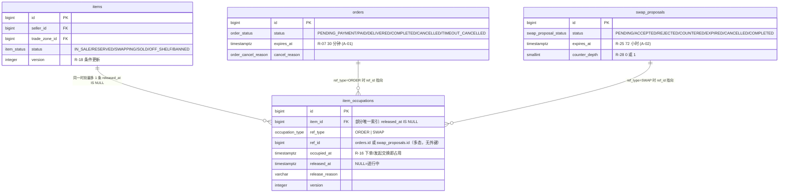
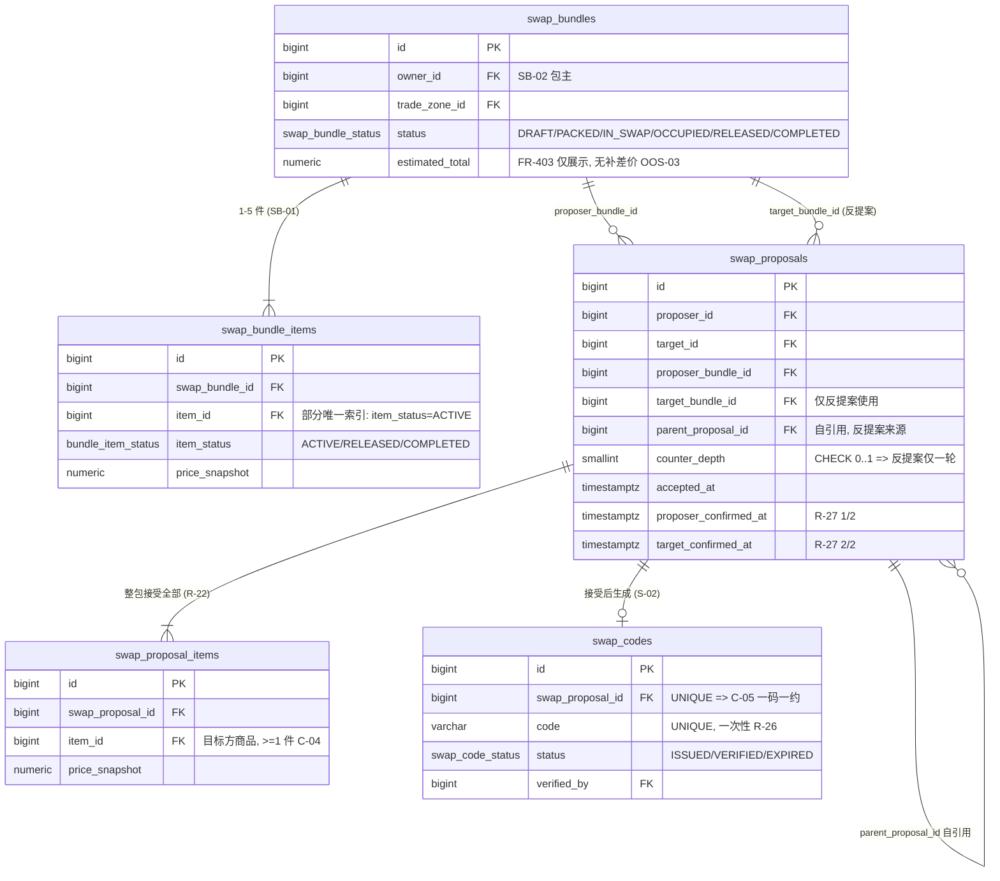
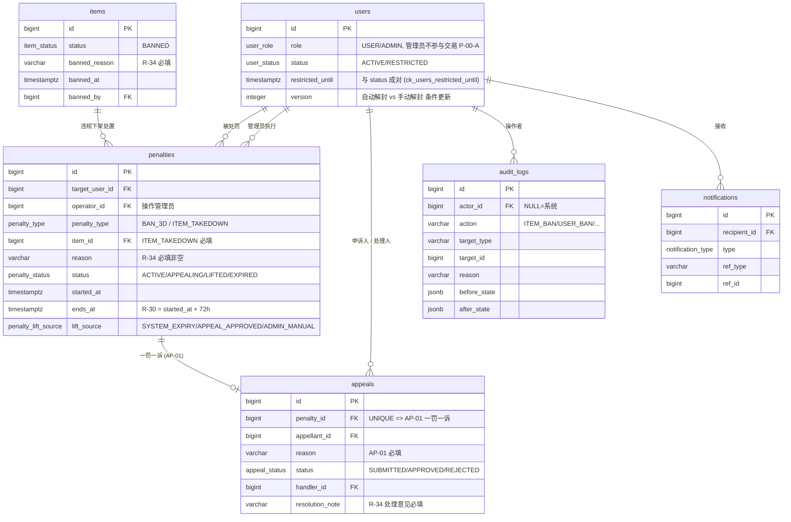

# 迭代一 实体关系图（ER Diagram）

| 项目 | 内容 |
| --- | --- |
| 文档名称 | 迭代一 实体关系图（ER Diagram） |
| 版本 | v1.0 |
| 日期 | 2026-10-12 |
| 作者 | 数据库与领域模型设计负责人（待填写姓名） |
| 状态 | 草稿（待确认） |
| 目标库 | PostgreSQL 15 |
| 对应迁移 | `src/main/resources/db/migration/V1__init_schema.sql` |
| 字段字典 | `schema.md` |
| 关联文档 | `../requirements.md` §6（文字化 ER）、`../state-machines.md`、`../rules.md` |

> 本图与 `V1__init_schema.sql` 一一对应，已在实际 PostgreSQL 15.19 上执行验证（见 `db-verification.md`）。
> 图中只画**核心业务列**（主键、外键、状态列、时间列），完整字段见 `schema.md`。

---

## 1. 总览图（核心交易链路）

```mermaid
erDiagram
    users ||--o{ user_trade_zones : "勾选 1-5 个常用区域 (FR-107)"
    trade_zones ||--o{ user_trade_zones : "被勾选"
    trade_zones ||--o{ pickup_points : "包含公共取货点 (R-06)"
    trade_zones ||--o{ items : "商品所属区域 (R-15)"
    trade_zones ||--o{ orders : "订单区域 (R-15)"
    trade_zones ||--o{ swap_bundles : "交换包区域 (R-15)"
    trade_zones ||--o{ swap_proposals : "交换提议区域 (R-15)"

    categories ||--o{ items : "分类 (FR-206)"
    item_conditions ||--o{ items : "成色 (FR-207)"

    users ||--o{ items : "作为卖家发布 (P-00-B 本人)"
    items ||--o{ item_images : "1-9 张图片 (FR-205)"

    users ||--o{ cart_items : "购物车 (FR-301)"
    items ||--o{ cart_items : "被加入"

    users ||--o{ orders : "作为买家 (buyer_id)"
    users ||--o{ orders : "作为卖家 (seller_id) 一单一卖家 C-02"
    pickup_points ||--o{ orders : "选定取货点 (R-06)"
    orders ||--|{ order_items : "订单明细 >=1"
    items ||--o{ order_items : "被下单（含快照 R-13）"
    orders ||--o| payments : "模拟付款记录 (R-08)"

    users ||--o{ items : "占用台账引用商品"
    items ||--o{ item_occupations : "占用台账 (C-01/R-23 核心)"

    users ||--o{ swap_bundles : "作为包主 (SB-02)"
    swap_bundles ||--|{ swap_bundle_items : "包含 1-5 件 (SB-01)"
    items ||--o{ swap_bundle_items : "被放入交换包"

    users ||--o{ swap_proposals : "作为发起方 proposer"
    users ||--o{ swap_proposals : "作为目标方 target"
    swap_bundles ||--o{ swap_proposals : "作为发起方交换包"
    swap_bundles ||--o{ swap_proposals : "作为反提案交换包 (target_bundle_id)"
    swap_proposals ||--o{ swap_proposal_items : "目标商品 >=1 (C-04)"
    items ||--o{ swap_proposal_items : "被请求"
    swap_proposals ||--o| swap_codes : "一次性交换码 (C-05/R-26)"
    swap_proposals ||--o{ swap_proposals : "反提案父子关系 (R-28 仅一轮)"

    users ||--o{ reviews : "作为评价人 reviewer"
    users ||--o{ reviews : "作为被评价人 reviewee"
    orders ||--o{ reviews : "订单评价 (R-14)"
    swap_proposals ||--o{ reviews : "交换评价"

    users ||--o{ reports : "举报人 (FR-211)"
    items ||--o{ reports : "被举报商品"

    users ||--o{ penalties : "被处罚用户 target_user_id"
    users ||--o{ penalties : "操作管理员 operator_id"
    items ||--o{ penalties : "违规下架处置 (P-02)"
    penalties ||--o| appeals : "申诉 (AP-01 一罚一诉)"

    users ||--o{ notifications : "接收通知 recipient_id (FR-507)"

    users ||--o{ idempotency_records : "幂等键归属 (R-17)"
    users ||--o{ audit_logs : "操作者 (R-34)"
```



---

## 2. 占用关系详图（C-01 / R-16 / R-23 的核心）

`item_occupations` 是全库唯一表达「商品被谁占用」的台账，`items.status` 只是它的投影。



**关键不变量（数据库级强制）**

```sql
-- 同一商品同时最多一个进行中占用：订单占用与交换占用天然互斥
CREATE UNIQUE INDEX uq_item_occ_active_item
    ON item_occupations (item_id) WHERE released_at IS NULL;
```

| 不变量 | 承载约束 | 对应需求 |
| --- | --- | --- |
| 一物一占用 | `uq_item_occ_active_item` | C-01 / R-16 |
| 订单占用与交换占用互斥 | 同上（同一索引统一保证） | R-23 |
| 商品占用态与台账一致 | 应用层同事务维护 + 对账查询（`db/verify_schema.sql` §11） | R-16 / I-07 / I-11 |

---

## 3. 交换关系详图（整包接受 R-22 / 整笔作废 R-24 / 反提案 R-28）



**交换的关键不变量**

| 不变量 | 承载约束 | 对应需求 |
| --- | --- | --- |
| 同一商品同时只在一个进行中交换包 | `uq_swap_bundle_items_active`（`WHERE item_status='ACTIVE'`） | SB-03 / R-21 |
| 一条提议最多一个交换码 | `uq_swap_codes_proposal` | C-05 |
| 交换码一次性 | `uq_swap_codes_code` + `ck_swap_codes_verified_trace` + `version` 条件更新 | R-26 / E-12 |
| **无部分接受** | 表结构上不存在 item 级接受字段；接受作用于整条提议 | **OOS-04 / R-22** |
| 反提案仅一轮 | `ck_swap_proposals_counter_depth CHECK (counter_depth BETWEEN 0 AND 1)` + `ck_swap_proposals_counter_source` | R-28 / A-10 |
| 完成必须双方确认 | `ck_swap_proposals_completed_trace`（要求两个确认时间均非空） | R-27 |
| 整笔作废可解释 | `termination_reason` 枚举（含 `VOID_ITEM_OCCUPIED` / `VOID_ITEM_OFF_SHELF` / `VOID_ITEM_BANNED`） | R-24 |

---

## 4. 治理关系详图（处罚 R-30 / 申诉 R-32 / 下架联动 R-35）



**治理关键不变量**

| 不变量 | 承载约束 | 对应需求 |
| --- | --- | --- |
| 同一用户同时最多一条生效中封禁 | `uq_penalties_one_active`（`WHERE status IN ('ACTIVE','APPEALING') AND penalty_type='BAN_3D'`） | R-30 / E-13 / Q-10 |
| 封禁固定 3 天 | `ck_penalties_period` + 应用层 `ends_at = started_at + 72h` | R-30 / A-03 |
| 治理动作必须填原因 | `ck_penalties_reason_not_blank`、应用层校验 `audit_logs.reason` | R-34 |
| 违规下架必须留痕 | `ck_items_banned_trace`（`BANNED` ⇒ reason/at/by 三者非空） | I-14 / I-15 |
| 处罚记录永不删除 | `penalties` / `appeals` 无 `deleted_at`，外键一律 `ON DELETE RESTRICT` | **R-32** |
| 一罚最多一诉 | `uq_appeals_penalty` | AP-01 |
| 解封必须成对记录 | `ck_penalties_lift_trace`（`LIFTED`/`EXPIRED` ⇒ `lifted_at` + `lift_source` 非空） | P-04/P-05/P-07 |

---

## 5. 基数说明汇总

| 关系 | 基数 | 依据 |
| --- | --- | --- |
| users → user_trade_zones | 1 : N（业务限 1–5） | FR-107 |
| trade_zones → pickup_points | 1 : N | requirements §2.3 |
| items → item_images | 1 : N（业务限 1–9） | FR-205 |
| items → item_occupations | 1 : N（**同时态 N ≤ 1**） | C-01 / R-16 / R-23 |
| orders → order_items | 1 : N（≥1） | FR-303 |
| orders → payments | 1 : 0..1（成功付款唯一） | R-08 |
| orders → reviews | 1 : 0..2（买卖双方各一） | R-14 |
| swap_bundles → swap_bundle_items | 1 : N（业务限 1–5） | SB-01 |
| swap_proposals → swap_proposal_items | 1 : N（≥1） | C-04 |
| swap_proposals → swap_codes | 1 : 0..1 | C-05 |
| swap_proposals → swap_proposals | 自引用 1 : N（反提案，深度 ≤ 1） | R-28 |
| penalties → appeals | 1 : 0..1 | AP-01 |
| users → penalties | 1 : N（同时态生效 BAN 数 ≤ 1） | R-30 |
| reports：users × items | **未处理态唯一** | C-06 |

---

## 6. 与需求文档文字化 ER 的差异说明

`../requirements.md` §6 给出的是**需求视角**的实体清单，本设计在落地时做了以下收敛，均不改变业务语义：

| # | 需求文档写法 | 本设计落地 | 理由 |
| --- | --- | --- | --- |
| 1 | `User` 与「个人资料」两个实体 | 合并为 `users` 单表 | 严格 1:1 且无独立生命周期，拆表只增加 JOIN（决策 D-02） |
| 2 | 未显式列出「库存占用」表 | 新增 `item_occupations` | 需求步骤 1 明确要求该实体；它是 C-01/R-23 的数据库级承载（决策 D-01） |
| 3 | `Order` 与 `OrderItem` | `orders` + `order_items` | 一单一卖家（C-02），明细行承载估价快照（R-13） |
| 4 | `SwapProposal` 未提及反提案父子关系 | 增加 `parent_proposal_id` + `counter_depth` | R-28「反提案仅一轮」需要结构表达，仅靠状态无法限制轮次 |
| 5 | 未提及幂等表 | 新增 `idempotency_records` | R-17 明确要求幂等键；E-06/E-16 需要请求体摘要比对 |
| 6 | 未提及审计表 | 新增 `audit_logs` | R-34 要求治理动作留痕（操作者/原因/前后状态） |
| 7 | 「评价」未区分订单/交换 | `reviews` 支持二者（二选一 CHECK） | 评价状态机同时服务购买与交换完成后的互评 |
| 8 | 「通知」未给字段 | `notifications` 含多态 `ref_type`/`ref_id` | FR-507 + 前端需要跳转到对应详情页 |

---

## 7. 版本与变更记录

| 版本 | 日期 | 变更人 | 变更内容 | 状态 |
| --- | --- | --- | --- | --- |
| v1.0 | 2026-10-12 | 数据库与领域模型设计负责人 | 初稿：总览图、占用/交换/治理三张详图、基数汇总、与需求文字化 ER 的差异说明 | 草稿（待确认） |
