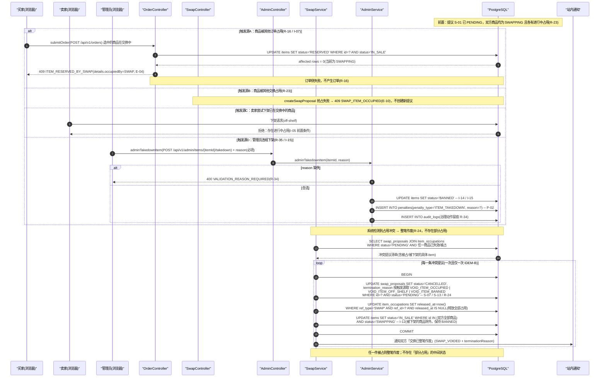
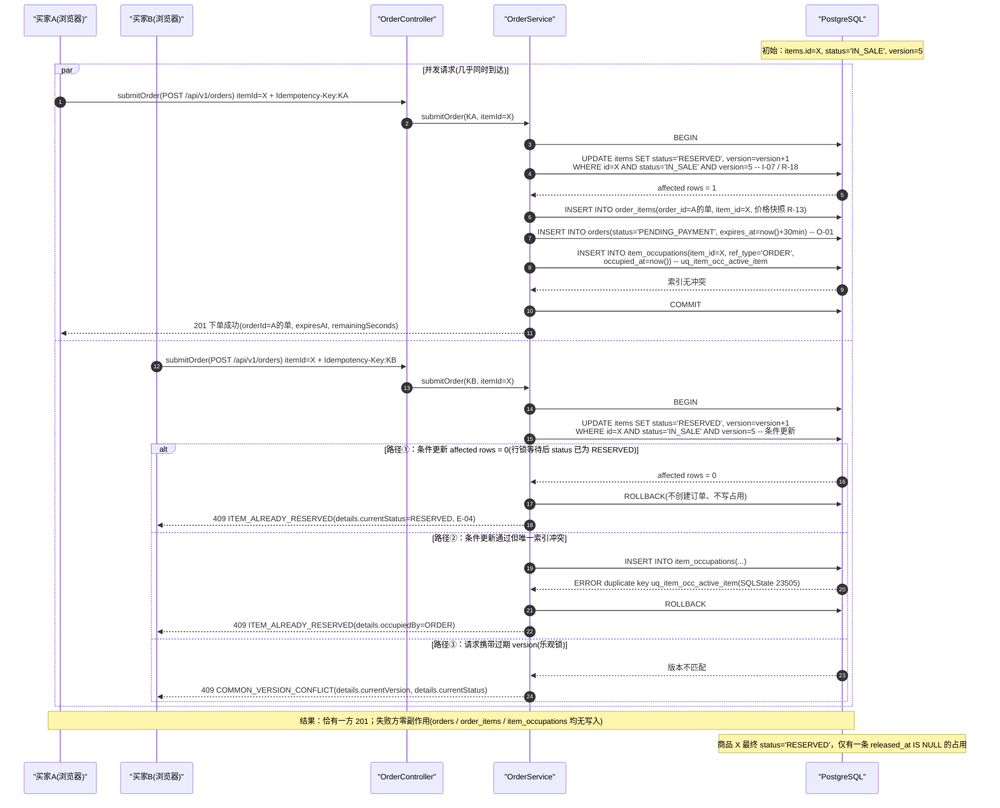
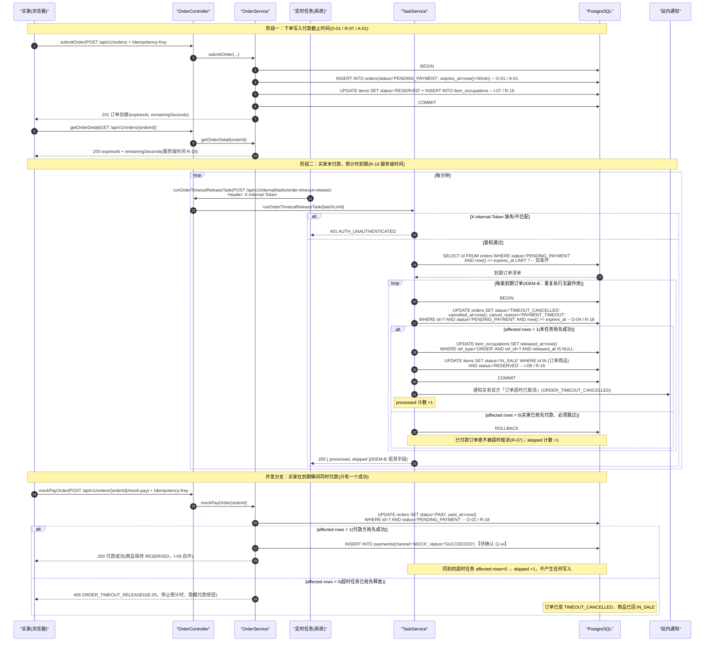
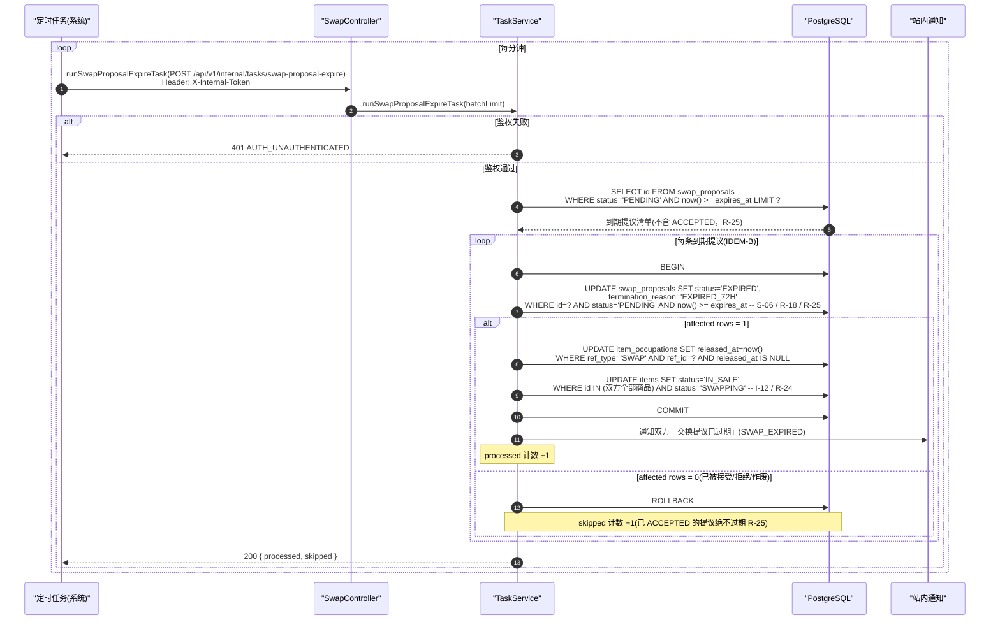
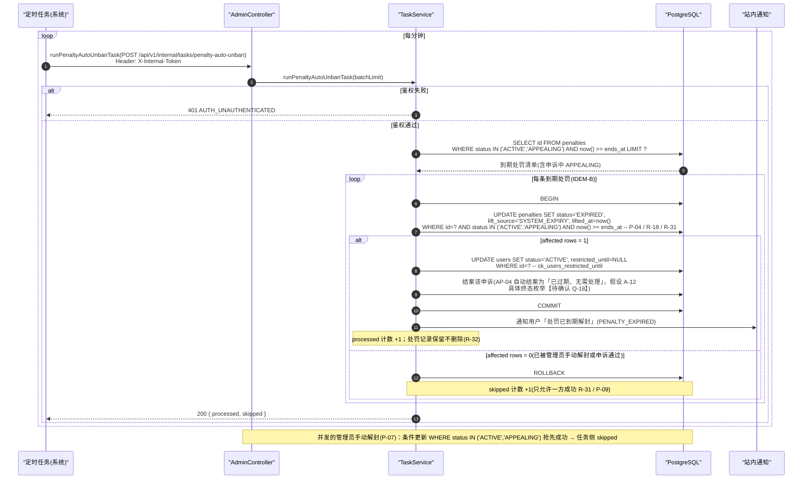
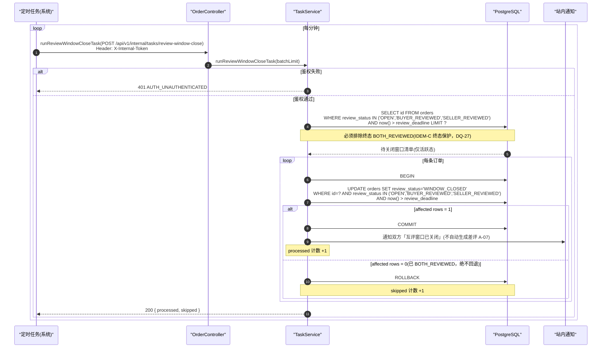

# 迭代一 关键流程时序图

| 项目 | 内容 |
| --- | --- |
| 文档名称 | 迭代一 关键流程时序图 |
| 版本 | v1.1 |
| 日期 | 2026-10-12 |
| 作者 | 系统设计文档负责人（待填写姓名） |
| 状态 | 草稿（待确认） |
| 契约真源 | `openapi.yaml`（`1.0.0-frozen-candidate`，73 paths / 83 operations） |
| 关联文档 | [`SystemDesign.md`](./SystemDesign.md)、[`api-contract.md`](./api-contract.md)、[`error-codes.md`](./error-codes.md)、[`idempotency-and-concurrency.md`](./idempotency-and-concurrency.md)、[`state-machines.md`](../state-machines.md)、[`rules.md`](../rules.md)、[`permission-matrix.md`](../permission-matrix.md)、[`out-of-scope.md`](../out-of-scope.md) |

> 本文件的接口、状态编号、规则编号与错误码均**派生自冻结候选契约**，不自造接口。
>
> **P-01 追溯优化（v1.1）**：每张时序图的说明表新增 **`覆盖 FR`** 行，使「时序图 → operationId → FR」
> 形成**一步直达**的追溯链（此前需经 `api-contract.md` §3 两步跳转）。
> 该行的 FR 编号**全部派生自** `api-contract.md` §3「FR 覆盖矩阵」与 §2「接口清单」的
> `#NN → operationId` 对照，**未新增或自造任何 FR 编号**；
> 对个别在 §3 矩阵中无独立 FR 行的支撑性/字典类接口（如 `listItems`、`adminListAuditLogs`），
> 按其在需求中的归属域就近归入对应 FR，并在 §8 交叉索引中保留完整 operationId 以便逐条核对。
> 关联文档在迭代一目录下的位置：`../state-machines.md`、`../rules.md`、`error-codes.md`、`idempotency-and-concurrency.md`、`api-contract.md`。
>
> **路径说明**：上表所列的 `state-machines.md`、`rules.md`、`permission-matrix.md`、`out-of-scope.md`
> 等**需求基线**文档位于 `docs/iteration1/`，而 `api-contract.md`、`error-codes.md`、
> `idempotency-and-concurrency.md`、`SystemDesign.md` 等**设计/契约**文档位于 `docs/iteration1/design/`。
> 本文中的相对链接已按实际路径书写（前者用 `../`，后者用 `./`）。
> `SystemDesign.md` 已由本步骤产出，与本文件同目录。文档索引见
> [`README.md`](./README.md)。

---

## 0. 阅读说明

1. **参与者的命名分层。** 本文所有参与者按**架构分层**命名，不使用具体类名之外的业务别名：
   - `前端/浏览器`（买家、卖家、发起方、目标方等业务角色均以前端参与者表示）；
   - `Controller`（如 `OrderController`、`SwapController`、`AdminController`）；
   - `Service`（如 `OrderService`、`SwapService`、`AdminService`、`TaskService`）；
   - `PostgreSQL`（数据库，含表、部分唯一索引、条件更新语义）；
   - `定时任务`（系统参与者，承载 `/api/v1/internal/tasks/*` 接口）。
   角色的**业务身份**（买家/卖家/管理员/举报人）通过参与者显示名区分，权限差异不在本文件展开（见 `api-permission-mapping.md`）。

2. **每一步跨越到后端的调用都标注真实 `operationId` 与 HTTP 路径。** 书写形如
   `BC->>SVC: submitOrder(POST /api/v1/orders)`。
   其中 `operationId` 与路径取自 `openapi.yaml` 的 `paths`。注意 `openapi.yaml` 的 `servers[0].url` 为
   `http://localhost:8080/api/v1`，因此契约中**相对路径**写作 `/orders`，本文为了可读性统一补全为
   **`/api/v1/...` 全路径**；两者指同一接口。

3. **状态转换引用 `state-machines.md` 的转换编号。** 本文出现的编号含义：
   - `I-xx`：商品（Item）状态机（如 `I-07` = IN_SALE → RESERVED）；
   - `O-xx`：订单（Order）状态机（如 `O-01` = 下单 → PENDING_PAYMENT）；
   - `S-xx`：交换提议（SwapProposal）状态机（如 `S-02` = 整包接受）；
   - `P-xx`：处罚（Penalty）状态机；`AP-xx`：申诉（Appeal）状态机；
   - `A-xx`：假设编号（`glossary-assumptions-questions.md`）；`C-xx`：关键约束编号（`requirements.md` §6）。
   每个 `Note` 或 DB 写入步骤旁标注对应转换编号，便于回溯。

4. **错误码来源。** 时序图中的失败分支错误码全部取自 `error-codes.md` 的「错误码总表」，并沿用其中的
   `E-xx` 编号、HTTP 状态码与 `details` 字段约定。错误码在图中以
   `返回 409 ITEM_ALREADY_RESERVED` 的形式标注。

5. **不确定项的处理。** 凡契约或上游文档未明确的内容，均以 **【待确认】** 标注并给出问题编号
   （`Q-xx` / `AQ-xx` / `DQ-xx`）。【待确认】不阻塞本文作为设计输入，但**阻塞对应接口的最终实现**。

6. **绘图约定。** 全部图形仅使用 Mermaid `sequenceDiagram`；渲染细节见 §9。

---

## 1. 购买主线 —— 从浏览到互评

| 维度 | 内容 |
| --- | --- |
| 参与角色 | 买家（浏览器）、卖家（浏览器）、`CartController`、`OrderController`、`CartService`、`OrderService`、PostgreSQL、站内通知 |
| 覆盖 operationId | `listItems`、`getItemDetail`、`addCartItem`、`getCart`、`submitOrder`、`getOrderDetail`、`mockPayOrder`、`selectPickupPoint`、`markOrderDelivered`、`confirmOrderReceipt`、`createOrderReview` |
| 覆盖 FR | FR-209、FR-210、FR-301、FR-302、FR-303、FR-304、FR-305、FR-306、FR-309、FR-310、FR-311、FR-312 |
| 涉及状态转换 | `O-01`（下单 → PENDING_PAYMENT）、`I-07`（商品 IN_SALE → RESERVED）、`O-02`（付款 → PAID）、`O-05`（选点，PAID 保持）、`O-06`（交付 → DELIVERED）、`O-07`（确认收货 → COMPLETED）、`I-10`（商品 → SOLD） |
| 关键规则 | **R-16**（下单即占用库存，占用发生在下单而非付款）、**R-05**（一单一卖家，跨卖家自动拆单）、**R-06**（取货点须 ∈ 订单交易区域，付款后才能选）、**R-08**（模拟付款、不涉真实资金）、**R-07**（30 分钟付款倒计时，服务端时间为准，假设 A-01）、**R-13**（估价快照仅展示、非定价）、**R-14**（评价前置：订单须 COMPLETED；7 天互评窗口，假设 A-07） |
| 可能出现的错误码 | `ITEM_ALREADY_RESERVED`、`ITEM_RESERVED_BY_SWAP`、`ITEM_NOT_PURCHASABLE`、`TRADE_ZONE_MISMATCH`、`ORDER_TIMEOUT_RELEASED`、`ORDER_ALREADY_CANCELLED`、`COMMON_VERSION_CONFLICT`、`VALIDATION_INVALID_PARAMETER`、`REVIEW_TRANSACTION_NOT_COMPLETED`、`REVIEW_ALREADY_SUBMITTED`、`USER_RESTRICTED_CANNOT_WRITE`（E-03 处罚期间禁止交易写入） |

补充说明：

- **占用发生在下单时。** `submitOrder` 成功即写 `item_occupations`（`occupied_at` 置值）并将 `items.status`
  投影为 `RESERVED`；后续 `mockPayOrder` **不再改变占用**，仅推进订单状态（`I-09` 为 RESERVED 自环）。
- **倒计时由服务端驱动。** `getOrderDetail` 返回 `expiresAt` 与 `remainingSeconds`，前端**禁止**自行推算（R-19）。
- **价格快照。** 下单时把商品估价写入 `order_items` 快照，后续商品改价不影响已创建订单（R-13）。
- **互评窗口。** `confirmOrderReceipt` 成功即开启 7 天互评窗口；窗口关闭由定时任务处理（见 §7.3）。
- 【待确认】**Q-xx**：`mockPayOrder` 是否**必须**写入 `payments` 表（本迭代为 MOCK 渠道、无真实资金），
  以及该写入是否与 `orders.paid_at` 在同一事务内。`schema.md` §5 已定义 `payments` 表，但 `openapi.yaml`
  的 `mockPayOrder` 描述未明确要求落表。

```mermaid
sequenceDiagram
    autonumber
    participant B as "买家(浏览器)"
    participant S as "卖家(浏览器)"
    participant CC as "CartController"
    participant OC as "OrderController"
    participant CS as "CartService"
    participant OS as "OrderService"
    participant DB as "PostgreSQL"
    participant N as "站内通知"

    Note over B,DB: 阶段一：浏览与加购
    B->>OC: listItems(GET /api/v1/items)
    OC->>OS: listItems(区域/分类/关键词分页)
    OS->>DB: SELECT items WHERE status='IN_SALE' AND trade_zone_id=?
    DB-->>OS: 在售商品分页
    OS-->>B: 200 商品列表(含 estimatedPrice，仅展示 R-13)

    B->>OC: getItemDetail(GET /api/v1/items/{itemId})
    OC->>OS: getItemDetail(itemId)
    OS->>DB: SELECT items + item_images + seller
    DB-->>OS: 商品详情(status, swapPreference, tradeZone)
    OS-->>B: 200 商品详情

    B->>CC: addCartItem(POST /api/v1/cart/items)
    CC->>CS: addCartItem(itemId)
    CS->>DB: 校验：非自家商品、同商品不重复(R-04)；status='IN_SALE'
    alt 商品已被占用(R-16)
        DB-->>CS: 占用存在 / status<>'IN_SALE'
        CS-->>B: 409 ITEM_ALREADY_RESERVED(E-04)
    else 商品被交换占用
        CS-->>B: 409 ITEM_RESERVED_BY_SWAP(E-04, details.occupiedBy=SWAP)
    else 校验通过
        CS->>DB: INSERT INTO cart_items(quantity=1, A-16)
        DB-->>CS: OK
        CS-->>B: 201 已加入购物车
    end

    B->>CC: getCart(GET /api/v1/cart)
    CC->>CS: getCart()
    CS->>DB: SELECT cart_items JOIN items
    DB-->>CS: 购物车条目(按卖家分组)
    CS-->>B: 200 购物车(含跨卖家拆分预览 R-05)

    Note over B,DB: 阶段二：提交订单(下单即占用 R-16)
    B->>OC: submitOrder(POST /api/v1/orders) + Idempotency-Key
    OC->>OS: submitOrder(请求头 Idempotency-Key)
    OS->>DB: SELECT idempotency_records WHERE idempotency_key=? AND endpoint=? (R-17)
    alt 幂等键重复(首次已成功)
        DB-->>OS: 已存在记录(同一订单)
        OS-->>B: 200 返回首次订单 -- IDEM-A(同一幂等键只创建一单，不重复占用)
    else 首次提交
        OS->>DB: BEGIN
        OS->>DB: 校验买家未被处罚(R-33) / 已勾选交易区域(R-15)
        OS->>DB: 按 seller_id 分组(R-05 一单一卖家，跨卖家拆单)
        loop 每个卖家分组 → 生成一笔订单
            OS->>DB: INSERT INTO orders(status='PENDING_PAYMENT', expires_at=now()+30min, A-01)  -- O-01
            OS->>DB: INSERT INTO order_items(价格/估价快照 R-13)
            OS->>DB: UPDATE items SET status='RESERVED' WHERE id=? AND status='IN_SALE' AND version=?  -- I-07 / R-18
            OS->>DB: INSERT INTO item_occupations(item_id, ref_type='ORDER', occupied_at=now())  -- I-07 / R-16
        end
        OS->>DB: DELETE FROM cart_items WHERE 已下单条目
        OS->>DB: INSERT INTO idempotency_records(idempotency_key, resource_type, resource_id,<br/>response_status, response_body)  -- R-17 / IDEM-A
        OS->>DB: COMMIT
        alt 任一商品 affected rows = 0 或唯一索引冲突
            OS->>DB: ROLLBACK(整批失败，不产生部分下单 A-17)
            OS-->>B: 409 ITEM_ALREADY_RESERVED(details.currentStatus=RESERVED, E-04)
        else 全部占用成功
            OS-->>B: 201 订单创建成功(orderIds)
            OS->>N: 通知卖家「有新订单待交付」(站内通知)
        end
    end

    Note over B,DB: 阶段三：倒计时内付款(O-02)
    B->>OC: getOrderDetail(GET /api/v1/orders/{orderId})
    OC->>OS: getOrderDetail(orderId)
    OS->>DB: SELECT orders + order_items + 角色视角
    DB-->>OS: 订单详情
    OS-->>B: 200 订单详情(expiresAt + remainingSeconds，服务端时间 R-19)

    B->>OC: mockPayOrder(POST /api/v1/orders/{orderId}/mock-pay) + Idempotency-Key
    OC->>OS: mockPayOrder(orderId)
    OS->>DB: UPDATE orders SET status='PAID', paid_at=now() WHERE id=? AND status='PENDING_PAYMENT'  -- O-02 / R-18
    alt affected rows = 1
        OS->>DB: INSERT INTO payments(channel='MOCK', status='SUCCEEDED') 【待确认 Q-xx】
        OS-->>B: 200 已付款(倒计时停止；商品仍为 RESERVED，I-09 自环)
    else 订单已超时释放(付款与超时并发，失败方)
        OS-->>B: 409 ORDER_TIMEOUT_RELEASED(E-05，停止倒计时)
    else 订单已取消
        OS-->>B: 409 ORDER_ALREADY_CANCELLED(E-05)
    end

    Note over B,S: 阶段四：选点 → 交付 → 确认收货(O-05/O-06/O-07)
    B->>OC: selectPickupPoint(PUT /api/v1/orders/{orderId}/pickup-point)
    OC->>OS: selectPickupPoint(orderId, pickupPointId)
    OS->>DB: 校验 pickup_points.trade_zone_id = orders.trade_zone_id(R-06/R-15)
    alt 取货点跨区
        OS-->>B: 422 TRADE_ZONE_MISMATCH(E-17)
    else 同区且订单未交付
        OS->>DB: UPDATE orders SET pickup_point_id=?, pickup_point_selected_at=now()  -- O-05
        OS-->>B: 200 已选择取货点
    end

    S->>OC: markOrderDelivered(POST /api/v1/orders/{orderId}/deliver)
    OC->>OS: markOrderDelivered(orderId)
    OS->>DB: 校验订单归属该卖家 + pickup_point_id IS NOT NULL(R-06)
    alt 未选点
        OS-->>S: 409 ORDER_PICKUP_POINT_NOT_SELECTED
    else 校验通过
        OS->>DB: UPDATE orders SET status='DELIVERED', delivered_at=now() WHERE status='PAID'  -- O-06
        OS->>N: 通知买家「已交付，请确认收货」
        OS-->>S: 200 已标记交付
    end

    B->>OC: confirmOrderReceipt(POST /api/v1/orders/{orderId}/confirm-receipt)
    OC->>OS: confirmOrderReceipt(orderId)
    OS->>DB: UPDATE orders SET status='COMPLETED', completed_at=now() WHERE id=? AND status='DELIVERED'  -- O-07
    alt affected rows = 1
        OS->>DB: UPDATE items SET status='SOLD' WHERE id IN (订单商品)  -- I-10
        OS->>DB: UPDATE orders SET review_status='OPEN', review_deadline=now()+7d  (A-07 / R-14)
        OS->>N: 通知卖家「买家已确认收货，互评窗口开启」
        OS-->>B: 200 交易完成
    else 订单未交付 / 已终态
        OS-->>B: 409 ORDER_STATUS_NOT_PAYABLE 或 ORDER_ALREADY_CANCELLED(O-10 终态保护，IDEM-C)
    end

    Note over B,S: 阶段五：互评(R-14 双方各一次)
    B->>OC: createOrderReview(POST /api/v1/orders/{orderId}/reviews)
    OC->>OS: createOrderReview(orderId, rating, content)
    OS->>DB: 校验 orders.status='COMPLETED' 且 review_deadline 未过
    alt 订单未完成
        OS-->>B: 409 REVIEW_TRANSACTION_NOT_COMPLETED(E-15)
    else 该方已评过
        OS-->>B: 409 REVIEW_ALREADY_SUBMITTED
    else 校验通过
        AS->>DB: INSERT INTO reviews(order_id, reviewer_id, reviewer_role='BUYER', rating, content)
        OS->>DB: UPDATE orders SET review_status='BUYER_REVIEWED'(或 BOTH_REVIEWED)
        OS->>N: 通知对方「收到评价」
        OS-->>B: 201 评价成功
    end
```

---

## 2. 交换主线 —— 发起、整包接受、交换码、双方确认

| 维度 | 内容 |
| --- | --- |
| 参与角色 | 发起方（浏览器）、目标方（浏览器）、`SwapController`、`SwapService`、PostgreSQL、站内通知 |
| 覆盖 operationId | `updateItemSwapPreference`、`createSwapBundle`、`createSwapProposal`、`getSwapProposal`、`acceptSwapProposal`、`rejectSwapProposal`、`counterSwapProposal`、`cancelSwapProposal`、`getSwapCode`、`verifySwapCode`、`confirmSwap` |
| 覆盖 FR | FR-210、FR-401、FR-402、FR-404、FR-405、FR-406、FR-407、FR-409、FR-410、FR-411、FR-412 |
| 涉及状态转换 | 提议：`S-01`（发起 → PENDING）、`S-02`（整包接受 → ACCEPTED）、`S-03`（拒绝 → REJECTED）、`S-04`（反提案 → COUNTERED）、`S-05`（取消 → CANCELLED）、`S-08`（核销交换码，ACCEPTED 自环）、`S-09`（单方确认，ACCEPTED 自环，记 1/2）、`S-10`（双方确认齐备 → COMPLETED）；商品：`I-11`（IN_SALE → SWAPPING）、`I-12`（SWAPPING → IN_SALE 释放）、`I-13`（SWAPPING → SOLD） |
| 关键规则 | **R-20**（交换意愿设置）、**R-21**（交换包 1–5 件且同 owner）、**R-22**（整包接受、不可部分接受 all-or-nothing）、**R-23**（同时占用双方全部商品、一物一占用）、**R-24**（整笔作废，见 §3）、**R-25**（72h 过期释放）、**R-26**（交换码一次性）、**R-27**（双方各确认一次）、**R-28**（反提案仅一轮） |
| 假设与约束 | `A-02`（提议有效期 72h）、`A-10`（反提案仅一轮）、`C-01`（一物最多一个进行中占用）、`C-03`（交换包 1–5 件同 owner）、`C-04`（目标商品 ≥1 件同 target）、`C-05`（一个提议最多一个交换码且一次性） |
| 可能出现的错误码 | `SWAP_ITEM_OCCUPIED`、`SWAP_TARGET_NOT_ACCEPTING`、`TRADE_ZONE_MISMATCH`、`SWAP_BUNDLE_ITEM_COUNT_OUT_OF_RANGE`、`SWAP_PROPOSAL_ALREADY_ACCEPTED`、`SWAP_CODE_ALREADY_VERIFIED`、`SWAP_COUNTER_NOT_ALLOWED`、`SWAP_PARTIAL_ACCEPT_NOT_SUPPORTED`、`SWAP_PROPOSAL_ALREADY_FINALIZED`、`SWAP_PROPOSAL_COUNTERED`、`ITEM_STATUS_NOT_SWAPPABLE`、`USER_RESTRICTED_CANNOT_WRITE` |

补充说明：

- **`SWAP_PARTIAL_ACCEPT_NOT_SUPPORTED`（OOS-04）**：`acceptSwapProposal` 的请求体**不接受**物品子集参数；
  任何「只接受其中几件」的请求都是越界调用。前端**不得**提供物品级勾选，整包接受是唯一合法语义（R-22）。
- **反提案只允许一轮**：`counterSwapProposal` 成功后原提议 → `COUNTERED`，并**新建**一条提议
  （`parent_proposal_id` 指向原提议、`counter_depth=1`）。对 `counter_depth=1` 的提议再次反提案返回
  `SWAP_COUNTER_NOT_ALLOWED`（R-28 / A-10，DB 侧 `ck_swap_proposals_counter_depth` 亦限制 ≤1）。
- **交换码一次性**：`verifySwapCode` 成功即写 `swap_codes.status='VERIFIED'` 与 `verified_at`/`verified_by`（库层枚举为 `ISSUED`/`VERIFIED`/`EXPIRED`，见 `schema.md` §6；首次签发即 `ISSUED`）；
  重复核销返回 `SWAP_CODE_ALREADY_VERIFIED`（R-26）。
- **确认顺序**：`S-09` 允许双方各自确认一次；`swap_proposals.proposer_confirmed_at` 与
  `target_confirmed_at` 齐备后才置 `COMPLETED`（DB 侧 `ck_swap_proposals_completed_trace`）。
  本迭代**不做**超时自动完成（`S-11` / 假设 A-10，【待确认】**Q-15**）。
- 【待确认】**DDP-01**（规则交叉引用错误，**经父级复核确认**）：
  `state-machines.md` 第 189 行 `S-07` 把「整笔作废」标注为「规则 **R-22** 的落地」，
  但按 `rules.md` 的定义 **R-22 = 整包接受、不可部分接受**，**R-24 = 整笔作废**。
  故该处应为 **R-24**。本文一律按 `rules.md` 的语义书写（整笔作废 → R-24）。
  **建议**：修正 `state-machines.md` S-07 一行的规则引用。
  该缺陷**未被本文与 `SystemDesign.md` 传播**（两文均正确使用 R-24）。
- 【已核实，非缺陷】**`error-codes.md` 的 `SWAP_PROPOSAL_ALREADY_ACCEPTED` 行标注「R-22 / S-02」是正确的**，
  因为该错误码对应「已整包接受 → 重复接受失败」，语义归属 **R-22（整包接受）**，与 S-02 对应。
  复核结论：此处**无需修改**；仅 `state-machines.md` S-07 一处需要修正。

```mermaid
sequenceDiagram
    autonumber
    participant P as "发起方(浏览器)"
    participant T as "目标方(浏览器)"
    participant SC as "SwapController"
    participant SS as "SwapService"
    participant DB as "PostgreSQL"
    participant N as "站内通知"

    Note over P,DB: 阶段一：交换意愿与交换包(R-20 / R-21)
    P->>SC: updateItemSwapPreference(PUT /api/v1/items/{itemId}/swap-preference)
    SC->>SS: updateItemSwapPreference(itemId, 'ACCEPTING')
    SS->>DB: 校验仅本人 + status NOT IN ('RESERVED','SWAPPING','SOLD','BANNED')
    alt 占用态/终态
        SS-->>P: 409 ITEM_STATUS_NOT_SWAPPABLE
    else 允许
        SS->>DB: UPDATE items SET swap_preference='ACCEPTING'
        SS-->>P: 200 已设置接受交换
    end

    P->>SC: createSwapBundle(POST /api/v1/swap-bundles)
    SC->>SS: createSwapBundle(itemIds[])
    SS->>DB: 校验件数 1–5 且全部 owner=本人(C-03)
    alt 件数越界
        SS-->>P: 422 SWAP_BUNDLE_ITEM_COUNT_OUT_OF_RANGE(details.currentCount/min/max)
    else 合法
        SS->>DB: INSERT INTO swap_bundles + swap_bundle_items
        SS-->>P: 201 交换包已创建
    end

    Note over P,DB: 阶段二：发起交换提议(S-01，同时占用双方全部商品 R-23)
    P->>SC: createSwapProposal(POST /api/v1/swap-proposals) + Idempotency-Key
    SC->>SS: createSwapProposal(offerBundleId, wantItemIds[], tradeZoneId)
    SS->>DB: 校验目标商品 ≥1 件且同一 target(C-04)；同交易区域(R-15)
    alt 目标商品不接受交换
        SS-->>P: 422 SWAP_TARGET_NOT_ACCEPTING(E-08)
    else 跨区域
        SS-->>P: 422 TRADE_ZONE_MISMATCH(E-17)
    else 区域与意愿合法
        SS->>DB: BEGIN
        SS->>DB: INSERT INTO swap_proposals(status='PENDING', counter_depth=0,<br/>expires_at=now()+72h, A-02)  -- S-01
        loop 包内全部商品(发起方)
            SS->>DB: UPDATE items SET status='SWAPPING' WHERE id=? AND status='IN_SALE' AND version=?  -- I-11 / R-18
            SS->>DB: INSERT INTO item_occupations(ref_type='SWAP', occupied_at=now())  -- R-23
        end
        loop 目标全部商品(目标方)
            SS->>DB: UPDATE items SET status='SWAPPING' WHERE id=? AND status='IN_SALE' AND version=?  -- I-11
            SS->>DB: INSERT INTO item_occupations(ref_type='SWAP', occupied_at=now())  -- R-23
        end
        SS->>DB: INSERT INTO swap_proposal_items(双向明细)
        SS->>DB: COMMIT
        alt 任一商品 affected rows=0 或 uq_item_occ_active_item 冲突(SQLState 23505)
            SS->>DB: ROLLBACK(整笔失败，不允许部分占用 R-24)
            SS-->>P: 409 SWAP_ITEM_OCCUPIED(details.occupiedBy=ORDER|SWAP, E-10)
        else 全部占用成功
            SS-->>P: 201 提议已创建(expiresAt + remainingSeconds)
            SS->>N: 通知目标方「收到交换提议」(SWAP_PROPOSED)
        end
    end

    T->>SC: getSwapProposal(GET /api/v1/swap-proposals/{proposalId})
    SC->>SS: getSwapProposal(proposalId)
    SS->>DB: SELECT swap_proposals + 双方 bundle/items + swap_codes
    DB-->>SS: 提议详情(status=PENDING, expireAt, counterDepth)
    SS-->>T: 200 提议详情(角色视角 role=PROPOSER|TARGET)

    Note over T,DB: 阶段三：整包接受(S-02，all-or-nothing R-22，生成一次性交换码 C-05)
    T->>SC: acceptSwapProposal(POST /api/v1/swap-proposals/{proposalId}/accept)
    SC->>SS: acceptSwapProposal(proposalId)  -- 请求体不接受物品子集
    alt 请求携带物品子集(OOS-04)
        SS-->>T: 422 SWAP_PARTIAL_ACCEPT_NOT_SUPPORTED(前端不得提供物品级勾选)
    else 提议已被接受
        SS-->>T: 409 SWAP_PROPOSAL_ALREADY_ACCEPTED(details.swapCodeId，不重复生成交换码)
    else 提议已终结
        SS-->>T: 409 SWAP_PROPOSAL_ALREADY_FINALIZED
    else 状态 PENDING 且未过期
        SS->>DB: BEGIN
        SS->>DB: UPDATE swap_proposals SET status='ACCEPTED', accepted_at=now()<br/>WHERE id=? AND status='PENDING' AND now()<expires_at  -- S-02 / R-18 / IDEM-B(重复接受不重复生成交换码)
        SS->>DB: INSERT INTO swap_codes(swap_proposal_id, code, status='ISSUED')  -- C-05
        SS->>DB: 保持双方全部 item_occupations 有效(occupied_at 不变)
        SS->>DB: COMMIT
        SS-->>T: 200 已接受(status=ACCEPTED)
        SS->>N: 通知发起方「提议已被接受，请线下交换」(SWAP_ACCEPTED)
    end

    T->>SC: getSwapCode(GET /api/v1/swap-proposals/{proposalId}/swap-code)
    SC->>SS: getSwapCode(proposalId)
    SS->>DB: SELECT swap_codes WHERE swap_proposal_id=? AND status='ISSUED'
    SS-->>T: 200 一次性交换码(code + 有效期)
    T->>P: 线下出示交换码(不走接口)
    P->>SC: verifySwapCode(POST /api/v1/swap-proposals/{proposalId}/swap-code/verify)
    SC->>SS: verifySwapCode(proposalId, code)
    SS->>DB: UPDATE swap_codes SET status='VERIFIED', verified_at=now(), verified_by=?<br/>WHERE code=? AND status='ISSUED'  -- S-08 / R-18
    alt affected rows = 1
        SS-->>P: 200 核销成功(一次性，C-05；IDEM-B 重复核销失败)
    else 交换码已核销
        SS-->>P: 409 SWAP_CODE_ALREADY_VERIFIED(details.verifiedAt, E-12)
    else 交换码不匹配
        SS-->>P: 422 SWAP_CODE_INVALID
    end

    Note over P,T: 阶段四：双方确认(S-09 → S-10，各一次 R-27)
    P->>SC: confirmSwap(POST /api/v1/swap-proposals/{proposalId}/confirm)
    SC->>SS: confirmSwap(proposalId)
    SS->>DB: 校验 status='ACCEPTED' 且 swap_codes.status='VERIFIED'(先核销后确认)
    alt 交换码未核销
        SS-->>P: 409 SWAP_CODE_NOT_VERIFIED
    else 该方此前未确认
        SS->>DB: UPDATE swap_proposals SET proposer_confirmed_at=now()  -- S-09(1/2)
        SS-->>P: 200 已确认(等待对方)
        SS->>N: 通知对方「对方已确认」
    end

    T->>SC: confirmSwap(POST /api/v1/swap-proposals/{proposalId}/confirm)
    SC->>SS: confirmSwap(proposalId)
    SS->>DB: UPDATE swap_proposals SET target_confirmed_at=now()  -- S-09(2/2)
    SS->>DB: UPDATE swap_proposals SET status='COMPLETED', completed_at=now()<br/>WHERE id=? AND status='ACCEPTED' AND proposer_confirmed_at IS NOT NULL  -- S-10
    SS->>DB: UPDATE items SET status='SOLD' WHERE id IN (双方全部商品)  -- I-13
    SS->>DB: UPDATE item_occupations SET released_at=now() WHERE ref_type='SWAP' AND ref_id=?
    SS-->>T: 200 交换已完成
    SS->>N: 通知双方「交换完成」(SWAP_COMPLETED)；开启互评窗口(R-14)

    Note over T,DB: 分支A：拒绝(S-03，释放双方全部占用 I-12)
    T->>SC: rejectSwapProposal(POST /api/v1/swap-proposals/{proposalId}/reject)
    SC->>SS: rejectSwapProposal(proposalId, reason)
    SS->>DB: UPDATE swap_proposals SET status='REJECTED', termination_reason='TARGET_REJECTED'<br/>WHERE id=? AND status='PENDING'  -- S-03
    SS->>DB: UPDATE items SET status='IN_SALE' WHERE id IN (双方全部商品)  -- I-12
    SS->>DB: UPDATE item_occupations SET released_at=now() WHERE ref_id=?
    SS->>N: 通知发起方「提议被拒绝」(SWAP_REJECTED)
    SS-->>T: 200 已拒绝

    Note over T,DB: 分支B：反提案(S-04，仅一轮 R-28)
    T->>SC: counterSwapProposal(POST /api/v1/swap-proposals/{proposalId}/counter)
    SC->>SS: counterSwapProposal(proposalId, 新交换包)
    alt 原提议 counter_depth=1(已是反提案)
        SS-->>T: 409 SWAP_COUNTER_NOT_ALLOWED(R-28/A-10)
    else 原提议 counter_depth=0 且 PENDING
        SS->>DB: BEGIN
        SS->>DB: UPDATE swap_proposals SET status='COUNTERED', termination_reason='COUNTERED'  -- S-04
        SS->>DB: UPDATE items SET status='IN_SALE' + 释放原提议全部占用  -- I-12
        SS->>DB: INSERT INTO swap_proposals(proposer=原目标方, target=原发起方,<br/>parent_proposal_id=原提议, counter_depth=1, status='PENDING')  -- S-01
        SS->>DB: 占用新提议自身的全部商品 → SWAPPING  -- I-11 / R-23
        SS->>DB: COMMIT
        SS-->>T: 201 反提案已创建(仅一轮)
        SS->>N: 通知原发起方「收到反提案」
    end

    Note over P,DB: 分支C：取消(S-05，仅发起方)
    P->>SC: cancelSwapProposal(POST /api/v1/swap-proposals/{proposalId}/cancel)
    SC->>SS: cancelSwapProposal(proposalId)
    SS->>DB: UPDATE swap_proposals SET status='CANCELLED', termination_reason='PROPOSER_CANCELLED'<br/>WHERE id=? AND status='PENDING'  -- S-05
    SS->>DB: UPDATE items SET status='IN_SALE' + 释放全部占用  -- I-12
    SS->>N: 通知目标方「提议已取消」(SWAP_CANCELLED)
    SS-->>P: 200 已取消
```

---

## 3. 交换整笔作废（R-24 / R-35）

| 维度 | 内容 |
| --- | --- |
| 参与角色 | 系统（占用冲突检测 / 联动）、卖家（浏览器）、管理员（浏览器）、`OrderController`、`SwapController`、`AdminController`、`SwapService`、`AdminService`、PostgreSQL、站内通知 |
| 覆盖 operationId | `submitOrder`（外部占用的产生方）、`adminTakedownItem`（管理员违规下架触发）、`getSwapProposal`（作废后可查）、`adminListAuditLogs`（审计留痕） |
| 覆盖 FR | FR-303、FR-304、FR-412、FR-502 |
| 涉及状态转换 | `S-07`（PENDING 且任一商品被其他占用/下架/违规下架 → **CANCELLED，原因=整笔作废**）、`S-13`（发起方商品被管理员违规下架 → CANCELLED，原因=违规）、`I-12`（SWAPPING → IN_SALE，释放占用）、`I-15`（RESERVED/SWAPPING → BANNED，管理员违规下架强制作废）、`I-14`（IN_SALE/OFF_SHELF → BANNED） |
| 关键规则 | **R-24**（整笔作废：任一件被占则全废，不存在部分占用）、**R-35**（违规商品下架联动取消订单/作废交换）、**R-23**（一物一占用）、**C-01**（一个商品同时最多一个进行中占用） |
| 关键数据 | `swap_proposals.status=CANCELLED`、`swap_proposals.termination_reason` ∈ {`VOID_ITEM_OCCUPIED`, `VOID_ITEM_OFF_SHELF`, `VOID_ITEM_BANNED`}【待确认 **DQ-29**】、`item_occupations.released_at` 置值、`items.status` 回到 `IN_SALE`（被下架的除外） |
| 可能出现的错误码 | `SWAP_ITEM_OCCUPIED`、`ITEM_ALREADY_RESERVED`、`SWAP_PROPOSAL_ALREADY_FINALIZED`、`SWAP_PROPOSAL_COUNTERED` |

补充说明：

- **作废是「整笔」而非「单件」。** R-24 与 R-22 的粒度**一致**：要么全成、要么全废，系统**不存在**
  「提议中一部分商品仍被占用」的中间态。因此作废时**必须**清空该提议的**全部** `item_occupations`。
- **触发源有三类**：① 商品被其他订单/交换抢先占用（`submitOrder` 或 `createSwapProposal` 先成功）；
  ② 卖家自行下架（`off-shelf`，`I-05` 前提是「无进行中占用」，故此类只能发生在占用建立之前，
  或由管理员路径覆盖）；③ 管理员违规下架（`adminTakedownItem`，`I-15`）。
- **作废只允许发生一次。** `IDEM-B`：重复检测到同一冲突时不得重复写 `termination_reason` 或重复通知。
- **作废的商品归还。** 未被下架的商品回到 `IN_SALE`（`I-12`）；被管理员下架的商品保持 `BANNED`
  （`I-15`），**不**回到 `IN_SALE`，由管理员通过 `adminRestoreItem`（`I-16`，见 §4）恢复。
- 【待确认】**DQ-29**：上述三个 `termination_reason` 字面量在 `schema.md`（`swap_termination_reason`
  枚举）与 `state-machines.md` 中均**未见明文定义**，本文按需求方给定的字面量书写，待契约确认后统一。
- 【待确认】**DQ-30**：卖家在**占用建立之后**尝试自行下架时的语义（拒绝并提示「有进行中交换」，
  还是触发整笔作废）在 `rules.md`/`state-machines.md` 中未明确；本文按 `I-05` 的前置条件
  取「有进行中占用 → 拒绝下架」的保守实现。

---

## 4. 治理主线 —— 举报 → 下架 → 封禁 → 申诉 → 解封

| 维度 | 内容 |
| --- | --- |
| 参与角色 | 用户A（举报人）、违规用户B、管理员（浏览器）、`ReportController`、`AdminController`、`AdminService`、PostgreSQL、审计（`audit_logs`）、站内通知 |
| 覆盖 operationId | `reportItem`、`adminListReports`、`adminHandleReport`、`adminTakedownItem`、`adminSearchUsers`、`adminBanUser`、`listMyPenalties`、`createAppeal`、`adminListAppeals`、`adminResolveAppeal`、`adminLiftPenalty`、`adminRestoreItem`、`adminListAuditLogs` |
| 覆盖 FR | FR-211、FR-412、FR-501、FR-502、FR-503、FR-504、FR-505 |
| 涉及状态转换 | 处罚：`P-01`（封禁 → ACTIVE，固定 72h）、`P-02`（违规商品下架处置记录）、`P-03`（申诉 → APPEALING）、`P-04`（到期自动解封 → EXPIRED）、`P-05`（申诉通过 → LIFTED）、`P-06`（申诉驳回 → ACTIVE）、`P-07`（管理员手动解封 → LIFTED）；申诉：`AP-01`（提交 → SUBMITTED）、`AP-02`（通过 → APPROVED）、`AP-03`（驳回 → REJECTED）；商品：`I-14`（管理员下架 → BANNED）、`I-15`（占用态下架 → BANNED 且强制作废）、`I-16`（恢复 → IN_SALE 或 OFF_SHELF） |
| 关键规则 | **R-30**（封禁默认且固定 3 天＝72h）、**R-31**（自动解封与手动/申诉并发只允许一方成功）、**R-32**（处罚记录**永不物理删除**，且一罚一诉）、**R-33**（处罚期间禁止交易类写入，白名单见权限矩阵 §8）、**R-34**（治理动作**必须**填原因并**必须**写 `audit_logs`）、**R-35**（违规商品下架联动取消订单/作废交换） |
| 假设与约束 | `A-03`（封禁固定 72h）、`A-11`（处罚期内随时可申诉）、`C-06`（同一用户对同一 Item 的未处理举报最多 1 条）、`C-07`（处罚期内不得产生新交易写入） |
| 可能出现的错误码 | `VALIDATION_REASON_REQUIRED`（治理域别名 `GOVERNANCE_REASON_REQUIRED`）、`GOVERNANCE_ACTIVE_PENALTY_EXISTS`（E-13，拒绝重复封禁）、`GOVERNANCE_CANNOT_PUNISH_ADMIN`、`APPEAL_ALREADY_EXISTS`、`APPEAL_ALREADY_RESOLVED`、`USER_RESTRICTED_CANNOT_WRITE`（E-03）、`ITEM_BANNED_CANNOT_RELIST` |

补充说明：

- **处罚记录永不物理删除（R-32）。** 申诉通过（`P-05`）、到期（`P-04`）、管理员手动解封（`P-07`）
  都**只更新状态与结案结论**，`penalties` 行永久保留，解封来源写入 `lift_source`、原因写入 `lift_reason`。
  同理，`reports`、`appeals` 亦不物理删除。
- **治理动作必须留痕（R-34）。** 下架、封禁、解封、恢复、举报处理、申诉处理**每一个**写操作都必须在
  同一事务内插入 `audit_logs`；缺 `reason`/`note` 一律返回 `400 VALIDATION_REASON_REQUIRED`。
- **`note` 与 `reason` 的必填边界。** `adminHandleReport` 的 `note` **必填**；`adminTakedownItem` 与
  `adminBanUser`、`adminLiftPenalty`、`adminRestoreItem`、`adminResolveAppeal` 的 `reason`/`note` **必填**。
- **一罚一诉（R-32 / AP-01）。** 一个处罚最多一条申诉；已 `SUBMITTED` 再提交返回 `APPEAL_ALREADY_EXISTS`；
  已 `APPROVED`/`REJECTED` 再处理返回 `APPEAL_ALREADY_RESOLVED`（AP-06 终态保护）。
- **申诉期间处罚保持生效（P-03）。** 提交申诉**不**解封，`users.status` 仍为受限态，直到 `P-05`/`P-06`/`P-04`。
- **封禁固定 3 天（R-30 / A-03）。** `adminBanUser` 不接受自定义时长，`ends_at = now() + 72h`。
- 【待确认】**Q-xx（用户状态枚举口径）**：`state-machines.md` 的 `P-01`/`P-04`/`P-05`/`P-07` 行把用户状态
  写作 `ROLE_RESTRICTED` / `ROLE_USER`，而 `schema.md` 的 `users.status`（`user_status` 枚举）与
  `ck_users_restricted_until` 用的是 `'RESTRICTED'` / `'ACTIVE'`。本文在图中统一使用**数据库列口径**
  （`RESTRICTED` / `ACTIVE`），并保留状态机行的语义。建议登记为 **DQ-31** 并统一措辞。
- 【待确认】**DQ-27（已登记，已修正）**：评价窗口关闭任务见 §7.3，此处不重复。

```mermaid
sequenceDiagram
    autonumber
    participant UA as "用户A(举报人)"
    participant UB as "违规用户B"
    participant ADM as "管理员(浏览器)"
    participant RC as "ReportController"
    participant AC as "AdminController"
    participant AS as "AdminService"
    participant DB as "PostgreSQL"
    participant AUD as "审计 audit_logs"
    participant N as "站内通知"

    Note over UA,DB: 阶段一：举报(C-06 同一用户对同一商品最多 1 条未处理举报)
    UA->>RC: reportItem(POST /api/v1/items/{itemId}/reports)
    RC->>AS: reportItem(itemId, reasonType, description)
    AS->>DB: SELECT reports WHERE reporter_id=? AND item_id=? AND status='PENDING'
    alt 已存在未处理举报
        AS-->>UA: 409 REPORT_ALREADY_EXISTS(C-06 幂等约束)
    else 首次举报
        AS->>DB: INSERT INTO reports(reporter_id, item_id, reason, status='PENDING')
        AS-->>UA: 201 举报已提交
    end

    Note over ADM,DB: 阶段二：管理员受理举报(R-34 note 必填 + 审计)
    ADM->>AC: adminListReports(GET /api/v1/admin/reports)
    AC->>AS: adminListReports(status=PENDING, 分页)
    AS->>DB: SELECT reports + items + reporter
    DB-->>AS: 待处理举报分页
    AS-->>ADM: 200 举报列表

    ADM->>AC: adminHandleReport(POST /api/v1/admin/reports/{reportId}/handle)
    AC->>AS: adminHandleReport(reportId, conclusion, note)
    alt note 缺失
        AS-->>ADM: 400 VALIDATION_REASON_REQUIRED(R-34)
    else note 齐备
        AS->>DB: BEGIN
        AS->>DB: UPDATE reports SET status='HANDLED', handled_by=?,<br/>handled_at=now(), handle_note=?  -- R-34 note 必填 / IDEM-A 重复处理返回首次结论
        AS->>AUD: INSERT INTO audit_logs(action='HANDLE_REPORT', target=reportId)  -- R-34
        AS->>DB: COMMIT
        AS-->>ADM: 200 举报已处理
        AS->>N: 通知举报人处理结果
    end

    Note over ADM,DB: 阶段三：违规商品下架(R-35 联动取消订单/作废交换)
    ADM->>AC: adminTakedownItem(POST /api/v1/admin/items/{itemId}/takedown) + reason(必填)
    AC->>AS: adminTakedownItem(itemId, reason)
    alt reason 缺失
        AS-->>ADM: 400 VALIDATION_REASON_REQUIRED(R-34)
    else 合法
        AS->>DB: BEGIN
        AS->>DB: UPDATE items SET status='BANNED'  -- I-14(在售/下架) 或 I-15(占用态)
        AS->>DB: UPDATE orders SET status='CANCELLED' / 'TIMEOUT_CANCELLED',<br/>cancel_reason='ADMIN_TAKEDOWN' WHERE 关联进行中订单  -- O-11 / R-35
        AS->>DB: UPDATE swap_proposals SET status='CANCELLED',<br/>termination_reason='VOID_ITEM_BANNED' WHERE 关联进行中交换  -- S-13 / R-24 / R-35
        AS->>DB: UPDATE item_occupations SET released_at=now() WHERE item_id=? AND released_at IS NULL
        AS->>DB: INSERT INTO penalties(penalty_type='ITEM_TAKEDOWN', reason=?)  -- P-02
        AS->>AUD: INSERT INTO audit_logs(action='TAKEDOWN_ITEM', reason=?)  -- R-34
        AS->>DB: COMMIT
        AS->>N: 通知卖家「商品因违规被下架」；通知相关买家/交换双方
        AS-->>ADM: 200 已下架
    end

    Note over ADM,DB: 阶段四：封禁(R-30 固定 72h，E-13 拒绝重复封禁)
    ADM->>AC: adminSearchUsers(GET /api/v1/admin/users)
    AC->>AS: adminSearchUsers(keyword, 分页)
    AS->>DB: SELECT users + 生效中处罚
    AS-->>ADM: 200 用户列表(含 activePenaltyId)

    ADM->>AC: adminBanUser(POST /api/v1/admin/users/{userId}/ban) + reason(必填)
    AC->>AS: adminBanUser(userId, reason)
    alt 目标是管理员
        AS-->>ADM: 403 GOVERNANCE_CANNOT_PUNISH_ADMIN
    else 已有生效中封禁
        AS->>DB: SELECT penalties WHERE target_user_id=? AND status IN ('ACTIVE','APPEALING')
        AS-->>ADM: 409 GOVERNANCE_ACTIVE_PENALTY_EXISTS<br/>(details.activePenaltyId, details.restrictedUntil, E-13)
    else reason 缺失
        AS-->>ADM: 400 VALIDATION_REASON_REQUIRED(R-34)
    else 允许封禁
        AS->>DB: BEGIN
        AS->>DB: INSERT INTO penalties(status='ACTIVE', started_at=now(), ends_at=now()+72h,<br/>operator_id=?, reason=?)  -- P-01 / R-30 / A-03
        AS->>DB: UPDATE users SET status='RESTRICTED', restricted_until=now()+72h  -- P-01
        AS->>AUD: INSERT INTO audit_logs(action='BAN_USER', reason=?)  -- R-34
        AS->>DB: COMMIT
        AS->>N: 通知用户B「账号已被限制 3 天」(PENALTY_ISSUED)
        AS-->>ADM: 200 已封禁(restrictedUntil)
    end

    Note over UB,DB: 阶段五：申诉(AP-01 一罚一诉；处罚保持生效 P-03)
    UB->>RC: listMyPenalties(GET /api/v1/users/me/penalties)
    RC->>AS: listMyPenalties(分页)
    AS->>DB: SELECT penalties WHERE target_user_id=当前用户
    DB-->>AS: 我的处罚记录(含 endsAt / liftSource / 结案结论，永不删除 R-32)
    AS-->>UB: 200 处罚列表

    UB->>RC: createAppeal(POST /api/v1/penalties/{penaltyId}/appeals)
    RC->>AS: createAppeal(penaltyId, reason 必填)
    alt 处罚非本人 / 状态非 ACTIVE
        AS-->>UB: 409 或 403 APPEAL_PENALTY_NOT_ACTIVE(P-08：已解封不可再申诉)
    else 该处罚已有申诉
        AS-->>UB: 409 APPEAL_ALREADY_EXISTS(AP-01 一罚一诉)
    else reason 缺失
        AS-->>UB: 400 VALIDATION_REASON_REQUIRED
    else 合法
        AS->>DB: BEGIN
        AS->>DB: INSERT INTO appeals(penalty_id, appellant_id, reason, status='SUBMITTED')  -- AP-01 / IDEM-A(同一处罚重复提交返回同一条)
        AS->>DB: UPDATE penalties SET status='APPEALING'  -- P-03(处罚保持生效)
        AS->>DB: COMMIT
        AS->>N: 通知管理员「有新的申诉待处理」
        AS-->>UB: 201 申诉已提交(账号仍处于限制中)
    end

    Note over ADM,DB: 阶段六：管理员裁决申诉(AP-02/AP-03，note 必填 + 审计)
    ADM->>AC: adminListAppeals(GET /api/v1/admin/appeals)
    AC->>AS: adminListAppeals(status=SUBMITTED)
    AS->>DB: SELECT appeals + penalties + users
    AS-->>ADM: 200 申诉列表

    ADM->>AC: adminResolveAppeal(POST /api/v1/admin/appeals/{appealId}/resolve)
    AC->>AS: adminResolveAppeal(appealId, decision='APPROVED'|'REJECTED', note)
    alt 申诉已处理
        AS-->>ADM: 409 APPEAL_ALREADY_RESOLVED(AP-06 终态保护)
    else note 缺失
        AS-->>ADM: 400 VALIDATION_REASON_REQUIRED(R-34)
    else 合法
        AS->>DB: BEGIN
        AS->>DB: UPDATE appeals SET status='APPROVED', handler_id=?,<br/>resolution_note=?, resolved_at=now()  -- AP-02
        AS->>DB: UPDATE penalties SET status='LIFTED', lifted_at=now(),<br/>lift_source='APPEAL_APPROVED'  -- P-05(记录保留，不物理删除 R-32)
        AS->>DB: UPDATE users SET status='ACTIVE', restricted_until=NULL
        AS->>AUD: INSERT INTO audit_logs(action='RESOLVE_APPEAL', note=?)  -- R-34
        AS->>DB: COMMIT
        AS->>N: 通知用户「申诉通过，已解封」(APPEAL_APPROVED)
        AS-->>ADM: 200 已裁决
    end
    Note over AS,DB: 若 decision='REJECTED' → appeals.status='REJECTED'(AP-03)、<br/>penalties.status 回到 'ACTIVE'(P-06)、用户保持限制至 ends_at

    Note over ADM,DB: 补充分支：手动解封(P-07) 与 商品恢复(I-16)
    ADM->>AC: adminLiftPenalty(POST /api/v1/admin/penalties/{penaltyId}/lift) + reason(必填)
    AC->>AS: adminLiftPenalty(penaltyId, reason)
    alt reason 缺失
        AS-->>ADM: 400 VALIDATION_REASON_REQUIRED(R-34)
    else 合法
        AS->>DB: BEGIN
        AS->>DB: UPDATE penalties SET status='LIFTED', lifted_at=now(),<br/>lift_source='ADMIN_MANUAL', lift_reason=?<br/>WHERE id=? AND status IN ('ACTIVE','APPEALING')  -- P-07 / R-18
        AS->>DB: UPDATE users SET status='ACTIVE', restricted_until=NULL
        AS->>AUD: INSERT INTO audit_logs(action='LIFT_PENALTY', reason=?)  -- R-34
        AS->>DB: COMMIT
        AS->>N: 通知用户「已提前解封」
        AS-->>ADM: 200 已解封
    end

    ADM->>AC: adminRestoreItem(POST /api/v1/admin/items/{itemId}/restore) + reason(必填)
    AC->>AS: adminRestoreItem(itemId, reason, targetStatus)
    AS->>DB: 校验无占用冲突 + reason 齐备
    alt 仍有占用冲突
        AS-->>ADM: 409 ITEM_ALREADY_RESERVED(details.currentStatus)
    else 合法
        AS->>DB: BEGIN
        AS->>DB: UPDATE items SET status='IN_SALE' 或 'OFF_SHELF'  -- I-16
        AS->>AUD: INSERT INTO audit_logs(action='RESTORE_ITEM', reason=?)  -- R-34
        AS->>DB: COMMIT
        AS-->>ADM: 200 已恢复
    end

    ADM->>AC: adminListAuditLogs(GET /api/v1/admin/audit-logs)
    AC->>AS: adminListAuditLogs(action, targetType, 时间区间, 分页)
    AS->>DB: SELECT audit_logs(只读，不可修改/删除)
    DB-->>AS: 审计日志分页
    AS-->>ADM: 200 审计日志(治理动作全量留痕 R-34)
```

---

## 5. 并发抢购 —— 两人同时抢最后一件商品

| 维度 | 内容 |
| --- | --- |
| 参与角色 | 买家A（浏览器）、买家B（浏览器）、`OrderController`、`OrderService`、PostgreSQL |
| 覆盖 operationId | `submitOrder`（两个并发请求，同一 `itemId`） |
| 覆盖 FR | FR-303、FR-304（并发抢购同属提交订单与库存预留语义） |
| 涉及状态转换 | `I-07`（IN_SALE → RESERVED，**仅一方成功**）、`O-01`（下单 → PENDING_PAYMENT，**仅成功方产生**）、`O-12`（并发冲突 → 本次提交失败，**不创建订单**） |
| 关键规则 | **R-16**（下单即占用，占用冲突在**下单时**暴露）、**R-18**（并发控制：**条件更新** + 部分唯一索引，**禁止「先查后改」**）、`C-01`（一个商品同时最多一个进行中占用） |
| 关键数据库机制 | ① 条件更新 `UPDATE items SET status='RESERVED' WHERE id=? AND status='IN_SALE' AND version=?`，以 `affected rows` 判定胜负；② 部分唯一索引 `uq_item_occ_active_item`（`ON item_occupations(item_id) WHERE released_at IS NULL`）作为最终兜底，冲突时 SQLState `23505` |
| 可能出现的错误码 | `ITEM_ALREADY_RESERVED`（409，`details.currentStatus=RESERVED`）、`COMMON_VERSION_CONFLICT`（409，`details.currentVersion`/`currentStatus`）、`ITEM_RESERVED_BY_SWAP`、`TRADE_ZONE_MISMATCH` |

补充说明：

- **禁止「先查后改」。** 先 `SELECT` 判断商品在售、再 `UPDATE` 的写法在并发下会产生两个订单（TOCTOU）。
  正确做法是**单条条件更新以 `affected rows` 判定**，或依赖 `uq_item_occ_active_item` 唯一索引兜底（R-18）。
- **失败方不产生订单。** 冲突方在**创建订单之前**失败：`orders` / `order_items` **零写入**，
  `item_occupations` **零写入**，仅返回 409。这是与「下单成功后再校验」的关键区别（R-16）。
- **两种冲突路径的区分。**
  - 路径①（条件更新）：`affected rows = 0`，说明商品已不是 `IN_SALE` → `ITEM_ALREADY_RESERVED`；
  - 路径②（唯一索引）：条件更新已通过但并发插入 `item_occupations` 撞唯一索引 → SQLState `23505`
    → 回滚并把该商品判为已被占用，返回同域 409。
  - 路径③（乐观锁）：若请求携带 `version` 且与库中不一致 → `COMMON_VERSION_CONFLICT`（`details.currentVersion`）。
- **同事务一致性。** 条件更新、`item_occupations` 插入、订单插入必须在**同一事务**内，任一失败整体回滚，
  不得留下「商品已 RESERVED 但没有订单」的悬挂状态。
- 时效性：本流程的两个请求**几乎同时**到达，时序图中用 `par` 语义表达并发，落地时由数据库行锁/唯一索引保证互斥。

---

## 6. 超时释放 —— 订单 30 分钟未付款

| 维度 | 内容 |
| --- | --- |
| 参与角色 | 买家（浏览器）、`OrderController`、`OrderService`、`TaskService`、定时任务（系统）、PostgreSQL、站内通知 |
| 覆盖 operationId | `submitOrder`（写入 `expires_at`）、`mockPayOrder`（与超时并发的一方）、`getOrderDetail`（读取 `expiresAt`/`remainingSeconds`）、`runOrderTimeoutReleaseTask`（`POST /internal/tasks/order-timeout-release`） |
| 覆盖 FR | FR-303、FR-304、FR-305、FR-306、FR-307、FR-601 |
| 涉及状态转换 | `O-01`（下单 → PENDING_PAYMENT，写 `expires_at = now + 30min`）、`O-02`（付款 → PAID，与超时互斥）、`O-04`（超时 → TIMEOUT_CANCELLED）、`I-08`（RESERVED → IN_SALE，释放占用） |
| 关键规则 | **R-07**（付款倒计时 30 分钟＝假设 A-01；服务端时间为准＝R-19；**已付款订单绝不被超时取消**）、**R-16**（占用在超时释放时归还）、**R-18**（条件更新保证付款与超时**只有一个成功**） |
| 幂等语义 | **IDEM-B**：`runOrderTimeoutReleaseTask` 重复执行**无副作用**；响应同时返回 `processed`（本次实际取消数）与 `skipped`（并发争抢中被跳过数）用于观测 |
| 内部鉴权 | 该接口为内部接口，要求请求头 **`X-Internal-Token`**；缺失或不匹配返回 401 |
| 可能出现的错误码 | `ORDER_TIMEOUT_RELEASED`（409，付款方在并发中失败）、`ORDER_ALREADY_CANCELLED`、`COMMON_VERSION_CONFLICT`、`AUTH_UNAUTHENTICATED` |

补充说明：

- **扫描条件是「状态 ∧ 时间」双条件。** `status='PENDING_PAYMENT' AND now() >= expires_at`
  缺一不可；已 `PAID` 的订单即使 `now() > expires_at` 也**绝不**被取消（R-07）。
- **释放占用是超时取消的必然后果。** 订单置 `TIMEOUT_CANCELLED`、`item_occupations.released_at` 置值、
  `items.status` 回 `IN_SALE`（`I-08`）必须在同一事务内完成，避免商品被永久锁死。
- **与付款的竞争。** 二者都使用 `WHERE status='PENDING_PAYMENT'` 的条件更新，因此数据库层面保证
  只有一个 `affected rows = 1`；失败方按「先完成者」语义返回结果：任务侧 `skipped` 计数 +1（无错误），
  买家侧返回 409 `ORDER_TIMEOUT_RELEASED`。
- **执行频率。** 契约描述为定时任务，本文按「每分钟执行一次」书写；建议以 `expires_at` 建索引，
  扫描区间使用 `now() - 一个宽限窗口` 以避免漏扫与重复扫。
- 【待确认】**DQ-32**：`runOrderTimeoutReleaseTask` 的**单次批处理上限**与「每分钟」的调度周期在
  `openapi.yaml` 中未明确规定；本文按「每分钟、批上限 500 条」示意，需在契约冻结时补齐。

---

## 7. 定时任务的过期与终态保护

### 7.1 交换提议 72 小时过期（`runSwapProposalExpireTask`）

| 维度 | 内容 |
| --- | --- |
| 参与角色 | 发起方、目标方、`SwapController`、`TaskService`、定时任务（系统）、PostgreSQL、站内通知 |
| 覆盖 operationId | `runSwapProposalExpireTask`（`POST /internal/tasks/swap-proposal-expire`） |
| 覆盖 FR | FR-408、FR-602 |
| 涉及状态转换 | `S-06`（PENDING 且 `now > expireAt` → EXPIRED）、`I-12`（SWAPPING → IN_SALE 释放占用） |
| 关键规则 | **R-25**（72 小时过期释放；定时任务幂等）、**A-02**（有效期 72h）、**R-24**（释放全部占用，不释放部分） |
| 幂等语义 | **IDEM-B**：重复执行无副作用；响应含 `processed` / `skipped` |
| 内部鉴权 | Header `X-Internal-Token` |
| 关键数据 | `swap_proposals.status='EXPIRED'`、`termination_reason='EXPIRED_72H'`【待确认 **DQ-29**】、全部 `item_occupations.released_at` 置值、`items.status` → `IN_SALE` |
| 可能出现的错误码 | `AUTH_UNAUTHENTICATED`、`SWAP_PROPOSAL_ALREADY_FINALIZED`（并发下别处已终结则 `skipped`） |

补充说明：

- **扫描条件**：`status='PENDING' AND now() >= expires_at`。**已 `ACCEPTED` 的提议绝不参与过期**（R-25）；
  `REJECTED` / `CANCELLED` / `COUNTERED` / `COMPLETED` 同为终态，亦不参与。
- `RUN` 与「目标方在到期瞬间接受」并发时，条件更新保证**只有一个成功**：
  接受成功则任务侧 `affected rows = 0` → `skipped` +1；任务成功则接受方返回
  `SWAP_PROPOSAL_ALREADY_FINALIZED`（见 §2 分支语义）。
- 释放占用必须覆盖**双方全部**商品（R-24），不允许部分释放。

### 7.2 封禁到期自动解封（`runPenaltyAutoUnbanTask`）

| 维度 | 内容 |
| --- | --- |
| 参与角色 | 被处罚用户、管理员、`AdminController`、`TaskService`、定时任务（系统）、PostgreSQL、站内通知 |
| 覆盖 operationId | `runPenaltyAutoUnbanTask`（`POST /internal/tasks/penalty-auto-unban`）、`adminLiftPenalty`（并发的一方） |
| 覆盖 FR | FR-505、FR-506、FR-603 |
| 涉及状态转换 | `P-04`（ACTIVE → EXPIRED，到期自动解封）、`P-07`（管理员手动解封 → LIFTED）、`P-05`（申诉通过 → LIFTED）、`P-09`（到期与申诉/手动解封并发，以先完成者为准） |
| 关键规则 | **R-31**（自动解封；与手动解封/申诉通过并发时**只允许一方成功**）、**R-30**（固定 72h）、**R-32**（处罚记录**永不物理删除**，仅更新状态与 `lift_source`） |
| 幂等语义 | **IDEM-B**：重复执行只解封一次；响应含 `processed` / `skipped` |
| 关键数据 | `penalties.status='EXPIRED'`、`lift_source='SYSTEM_EXPIRY'`【待确认 **DQ-29**】、`users.status` → `ACTIVE`、`users.restricted_until = NULL`（满足 `ck_users_restricted_until`） |
| 可能出现的错误码 | `AUTH_UNAUTHENTICATED`、`COMMON_VERSION_CONFLICT`、`APPEAL_ALREADY_RESOLVED` |

补充说明：

- **扫描条件**：`status IN ('ACTIVE','APPEALING') AND now() >= ends_at`。
  扫描 `APPEALING` 是必要的：处于申诉中的处罚**到期同样自动解封**（`P-03` → `P-04`），
  且到期后未处理的申诉按假设 `A-12` 自动结案（`AP-04`，【待确认】**Q-18**）。
- **三方竞争只允许一方成功**：自动解封（`P-04`）、管理员手动解封（`P-07`）、申诉通过（`P-05`）
  都使用条件更新 `WHERE status IN ('ACTIVE','APPEALING')`，`affected rows = 0` 的一方必须放弃并计 `skipped`，
  不得重复写通知（R-31 / `P-09`）。
- **记录保留**：任务只 `UPDATE`，**绝不** `DELETE`；`penalties` 行保留 `lift_source='SYSTEM_EXPIRY'`
  以供审计回溯（R-32）。
- `users` 与 `penalties` 的更新必须在**同一事务**内，否则会出现「处罚已 EXPIRED 但用户仍 RESTRICTED」。

### 7.3 评价窗口关闭（`runReviewWindowCloseTask`）—— 终态保护

| 维度 | 内容 |
| --- | --- |
| 参与角色 | 买家、卖家、`OrderController`、`TaskService`、定时任务（系统）、PostgreSQL、站内通知 |
| 覆盖 operationId | `runReviewWindowCloseTask`（`POST /internal/tasks/review-window-close`） |
| 覆盖 FR | FR-604 |
| 涉及状态转换 | 评价窗口状态机：`OPEN` / `BUYER_REVIEWED` / `SELLER_REVIEWED` → `WINDOW_CLOSED`；**终态 `BOTH_REVIEWED` / `WINDOW_CLOSED` 受 IDEM-C 保护** |
| 关键规则 | **R-14**（互评窗口 7 天＝假设 A-07）、`A-07`（超期关闭且**不自动生成差评**）、**IDEM-C**（终态保护）、**DQ-27**（扫描条件必须排除 `BOTH_REVIEWED`） |
| 幂等语义 | 幂等：重复执行无副作用；已关闭窗口不再处理 |
| 内部鉴权 | Header `X-Internal-Token` |
| 关键数据 | `orders.review_status='WINDOW_CLOSED'`、`orders.review_deadline` |
| 可能出现的错误码 | `AUTH_UNAUTHENTICATED` |

补充说明：

- **扫描条件（已按 DQ-27 修正）**：
  `review_status IN ('OPEN','BUYER_REVIEWED','SELLER_REVIEWED') AND now() > review_deadline`。
  **必须排除终态 `BOTH_REVIEWED`**；若按早期写法 `review_status <> 'WINDOW_CLOSED'`，会把已是
  `BOTH_REVIEWED` 的订单**回退**为 `WINDOW_CLOSED`，抹掉「双方均已评价」的事实并违反终态保护（IDEM-C）。
  该缺陷已在迁移 `V4__fix_review_window_index.sql` 与 `openapi.yaml` 的 `x-locking` 中修正（见 `open-questions.md` **DQ-27**）。
- **不自动生成差评**（`A-07`）：窗口关闭只改状态，**不**创建 `reviews` 记录，也**不**改变双方信用/评分。
- 窗口关闭与「最后一方在截止瞬间提交评价」并发时，条件更新保证只有一方推进状态：若评价先成功则
  订单为 `BOTH_REVIEWED`，任务扫描条件已将其排除，天然不会覆盖。

---

## 8. 时序图与接口/状态交叉索引

| 时序图 | 覆盖 operationId（逗号分隔） | 覆盖 FR | 状态转换编号 | 关键规则 | 主要错误码 |
| --- | --- | --- | --- | --- | --- |
| §1 购买主线（浏览 → 互评） | `listItems`, `getItemDetail`, `addCartItem`, `getCart`, `submitOrder`, `getOrderDetail`, `mockPayOrder`, `selectPickupPoint`, `markOrderDelivered`, `confirmOrderReceipt`, `createOrderReview` | FR-209、FR-210、FR-301、FR-302、FR-303、FR-304、FR-305、FR-306、FR-309、FR-310、FR-311、FR-312 | `O-01`, `I-07`, `O-02`, `O-05`, `O-06`, `O-07`, `I-10`, `O-10` | R-16, R-05, R-06, R-08, R-07, R-13, R-14, R-18, R-19 | `ITEM_ALREADY_RESERVED`, `ITEM_RESERVED_BY_SWAP`, `ITEM_NOT_PURCHASABLE`, `TRADE_ZONE_MISMATCH`, `ORDER_TIMEOUT_RELEASED`, `ORDER_ALREADY_CANCELLED`, `COMMON_VERSION_CONFLICT`, `REVIEW_TRANSACTION_NOT_COMPLETED`, `REVIEW_ALREADY_SUBMITTED` |
| §2 交换主线（发起 → 接受 → 交换码 → 确认） | `updateItemSwapPreference`, `createSwapBundle`, `createSwapProposal`, `getSwapProposal`, `acceptSwapProposal`, `rejectSwapProposal`, `counterSwapProposal`, `cancelSwapProposal`, `getSwapCode`, `verifySwapCode`, `confirmSwap` | FR-210、FR-401、FR-402、FR-404、FR-405、FR-406、FR-407、FR-409、FR-410、FR-411、FR-412 | `S-01`, `S-02`, `S-03`, `S-04`, `S-05`, `S-08`, `S-09`, `S-10`, `I-11`, `I-12`, `I-13` | R-20, R-21, R-22, R-23, R-24, R-25, R-26, R-27, R-28 | `SWAP_ITEM_OCCUPIED`, `SWAP_TARGET_NOT_ACCEPTING`, `TRADE_ZONE_MISMATCH`, `SWAP_BUNDLE_ITEM_COUNT_OUT_OF_RANGE`, `SWAP_PROPOSAL_ALREADY_ACCEPTED`, `SWAP_PROPOSAL_ALREADY_FINALIZED`, `SWAP_PROPOSAL_COUNTERED`, `SWAP_CODE_ALREADY_VERIFIED`, `SWAP_COUNTER_NOT_ALLOWED`, `SWAP_PARTIAL_ACCEPT_NOT_SUPPORTED`, `ITEM_STATUS_NOT_SWAPPABLE` |
| §3 交换整笔作废 | `submitOrder`, `adminTakedownItem`, `getSwapProposal`, `adminListAuditLogs` | FR-303、FR-304、FR-412、FR-502 | `S-07`, `S-13`, `I-12`, `I-14`, `I-15` | R-24, R-35, R-23, R-34, C-01 | `SWAP_ITEM_OCCUPIED`, `ITEM_ALREADY_RESERVED`, `SWAP_PROPOSAL_ALREADY_FINALIZED`, `VALIDATION_REASON_REQUIRED` |
| §4 治理主线（举报 → 下架 → 封禁 → 申诉 → 解封） | `reportItem`, `adminListReports`, `adminHandleReport`, `adminTakedownItem`, `adminSearchUsers`, `adminBanUser`, `listMyPenalties`, `createAppeal`, `adminListAppeals`, `adminResolveAppeal`, `adminLiftPenalty`, `adminRestoreItem`, `adminListAuditLogs` | FR-211、FR-412、FR-501、FR-502、FR-503、FR-504、FR-505 | `P-01`, `P-02`, `P-03`, `P-04`, `P-05`, `P-06`, `P-07`, `P-09`, `AP-01`, `AP-02`, `AP-03`, `I-14`, `I-15`, `I-16` | R-30, R-31, R-32, R-33, R-34, R-35 | `VALIDATION_REASON_REQUIRED`, `GOVERNANCE_REASON_REQUIRED`, `GOVERNANCE_ACTIVE_PENALTY_EXISTS`, `GOVERNANCE_CANNOT_PUNISH_ADMIN`, `USER_RESTRICTED_CANNOT_WRITE`, `APPEAL_ALREADY_EXISTS`, `APPEAL_ALREADY_RESOLVED`, `ITEM_BANNED_CANNOT_RELIST` |
| §5 并发抢购（两人抢最后一件） | `submitOrder` | FR-303、FR-304 | `I-07`, `O-01`, `O-12` | R-16, R-18, C-01 | `ITEM_ALREADY_RESERVED`, `ITEM_RESERVED_BY_SWAP`, `COMMON_VERSION_CONFLICT` |
| §6 超时释放（30 分钟未付款） | `submitOrder`, `getOrderDetail`, `mockPayOrder`, `runOrderTimeoutReleaseTask` | FR-303、FR-304、FR-305、FR-306、FR-307、FR-601 | `O-01`, `O-02`, `O-04`, `I-07`, `I-08`, `I-09` | R-07, R-16, R-18, R-19, A-01 | `ORDER_TIMEOUT_RELEASED`, `ORDER_ALREADY_CANCELLED`, `COMMON_VERSION_CONFLICT`, `AUTH_UNAUTHENTICATED` |
| §7.1 交换提议 72h 过期 | `runSwapProposalExpireTask` | FR-408、FR-602 | `S-06`, `I-12` | R-25, R-24, A-02 | `AUTH_UNAUTHENTICATED` |
| §7.2 封禁到期自动解封 | `runPenaltyAutoUnbanTask`, `adminLiftPenalty` | FR-505、FR-506、FR-603 | `P-04`, `P-07`, `P-05`, `P-09`, `AP-04` | R-31, R-30, R-32, A-03, A-12 | `AUTH_UNAUTHENTICATED`, `COMMON_VERSION_CONFLICT`, `APPEAL_ALREADY_RESOLVED` |
| §7.3 评价窗口关闭（终态保护） | `runReviewWindowCloseTask` | FR-604 | 评价窗口：`OPEN`/`BUYER_REVIEWED`/`SELLER_REVIEWED` → `WINDOW_CLOSED`（`BOTH_REVIEWED` 受 IDEM-C 保护） | R-14, A-07, IDEM-C, DQ-27 | `AUTH_UNAUTHENTICATED` |

【待确认】清单（本文提出，建议在 `open-questions.md` / `api-open-questions.md` 登记）：

| 暂定编号 | 待确认内容 | 影响范围 | 关联 |
| --- | --- | --- | --- |
| （已闭环）| ~~关联文档 `SystemDesign.md` 尚不存在~~ → **已产出**（与本文同目录）。需求基线文档位于 `docs/iteration1/`、设计契约文档位于 `docs/iteration1/design/`，相对路径已按实际书写 | 文档索引 | 本文 §0 |
| DDP-01 | **`state-machines.md` 第 189 行 `S-07`** 把「整笔作废」标注为「R-22 的落地」，应为 **R-24**（R-22 = 整包接受）。已复核确认；`error-codes.md` 的同类标注**是正确的**，无需修改 | 规则交叉引用一致性 | 本文 §2、§3 |
| DQ-29 | `termination_reason` / `cancel_reason` / `lift_source` 的具体枚举字面量（`VOID_ITEM_*`、`EXPIRED_72H`、`PAYMENT_TIMEOUT`、`SYSTEM_EXPIRY`）未在 `schema.md` 明文列出 | 数据库枚举与接口响应 | 本文 §3、§6、§7 |
| DQ-30 | 占用建立之后卖家自行下架的语义（拒绝 vs 整笔作废） | `I-05` 与 R-24 边界 | 本文 §3 |
| DQ-31 | 用户状态枚举口径：`state-machines.md` 用 `ROLE_RESTRICTED`/`ROLE_USER`，`schema.md` 用 `RESTRICTED`/`ACTIVE` | 状态机与库层措辞统一 | 本文 §4 |
| DQ-32 | `/api/v1/internal/tasks/*` 的调度周期与单批处理上限未在契约中规定 | 定时任务实现与容量 | 本文 §6、§7 |
| Q-xx（付款落表） | `mockPayOrder` 是否必须写入 `payments` 表及事务边界 | 订单付款实现 | 本文 §1、§6 |

---

## 8.1 相关文件导览

| 文件 | 位置 | 内容 |
| --- | --- | --- |
| [`README.md`](./README.md) | 同目录 | 设计目录索引与建议阅读顺序 |
| [`SystemDesign.md`](./SystemDesign.md) | 同目录 | 迭代一系统设计文档（本文的配套总纲） |
| [`openapi.yaml`](./openapi.yaml) | 同目录 | 接口契约（唯一真源，83 操作） |
| [`api-contract.md`](./api-contract.md) | 同目录 | 83 个接口清单与 54 FR 映射 |
| [`api-permission-mapping.md`](./api-permission-mapping.md) | 同目录 | 7 主体 × 6 域权限映射与越权测试 |
| [`error-codes.md`](./error-codes.md) | 同目录 | 93 个错误码 |
| [`idempotency-and-concurrency.md`](./idempotency-and-concurrency.md) | 同目录 | 幂等与并发说明 |
| [`er-diagram.md`](./er-diagram.md) / [`schema.md`](./schema.md) | 同目录 | ER 图 / 25 表字段字典 |
| [`state-machines.md`](../state-machines.md) | 需求基线 | 状态机与转换编号（本文引用其 I-/O-/S-/B-/P-/AP- 编号） |
| [`rules.md`](../rules.md) | 需求基线 | 34 条规则（R-01~R-35） |
| [`permission-matrix.md`](../permission-matrix.md) | 需求基线 | 7 主体权限矩阵 |
| [`out-of-scope.md`](../out-of-scope.md) | 需求基线 | 不做清单 18 项 |

---

## 9. Mermaid 渲染说明

1. **仅使用 `sequenceDiagram`。** 本文全部图形都是时序图，不使用 `flowchart`、`stateDiagram`、`classDiagram`
   等其他图型，确保在 GitHub、VS Code（Markdown Preview Mermaid Support）、Typora 中一致渲染。
2. **使用的语法元素（白名单）**：`participant ... as "显示名"`、`->>`（实线箭头，请求/调用）、
   `-->>`（虚线箭头，响应/返回）、`Note over A,B: 文本`（步骤与规则批注）、`alt` / `else` / `end`
   （分支，用于成功/失败路径）、`par` / `and` / `end`（并发，见 §5）、`opt`（可选分支）、`loop`（重复，
   用于批量任务与拆单），以及 `autonumber`（自动编号，便于评审时逐步对照）。
3. **不嵌套 `alt` 超过两层。** 本文最深处为「外层 `alt`（幂等/校验分支）→ 内层 `alt`（并发结果）」两层；
   再深的判断一律拆成并列的 `alt` 或改用 `Note` 说明，避免 Mermaid 解析与可读性劣化。
4. **参与者别名使用 ASCII。** 语法位（`participant BC as ...`）一律用纯字母缩写（如 `BC`、`SVC`、`DB`、
   `OC`、`SC`、`AC`、`TS`、`TASK`、`N`）；含 `/`、`(`、`（`、`、`、空格或中文标点的**显示名一律加双引号**，
   例如 `participant OC as "OrderController"`、`participant B as "买家(浏览器)"`、
   `participant TASK as "定时任务(系统)"`、`participant AUD as "审计 audit_logs"`。
5. **箭头标签中的特殊字符。** 标签中的路径、`{orderId}`、`+`、`=`、`|` 等均为纯文本，不需要转义；
   但当一行过长时使用 `&#96; &#96;`（Mermaid 的 ` `）换行，避免横向滚动。
   **不要**在标签中使用裸 `;`、裸 `#` 或反引号包裹，以免被解析为注释或 Markdown 代码。
6. **`par` 的兼容性。** §5 的并发抢购使用 `par ... and ... end`。若目标渲染器不支持 `par`，
   可降级为两个串行的 `Note` 块（语义不变：两个请求几乎同时到达，胜负由数据库条件更新与
   部分唯一索引 `uq_item_occ_active_item` 决定）。
7. **状态与规则的表达方式。** 状态转换以行内注释形式标注（如 `-- O-01 / R-18`），
   不把 Mermaid 当作状态机图使用；状态机的权威表示见 `state-machines.md`。

---

## 10. 版本与变更记录

| 版本 | 日期 | 作者 | 变更内容 | 状态 |
| --- | --- | --- | --- | --- |
| v1.1 | 2026-10-12 | 交付负责人 | **P-01 追溯优化**：9 张时序图说明表各新增 `覆盖 FR` 行；§8 交叉索引表新增 `覆盖 FR` 列；补充 FR 派生口径说明（全部来自 `api-contract.md` §3，未自造编号） | 草稿（待确认） |
| v1.0 | 2026-10-12 | 系统设计文档负责人（待填写姓名） | 首版：建立 7 组关键流程时序图（购买主线、交换主线、交换整笔作废、治理主线、并发抢购、超时释放、定时任务过期/解封/评价窗口关闭），并补充接口与状态交叉索引、Mermaid 渲染说明；提出 DQ-28 ~ DQ-32 与付款落表待确认项 | 草稿（待确认） |
